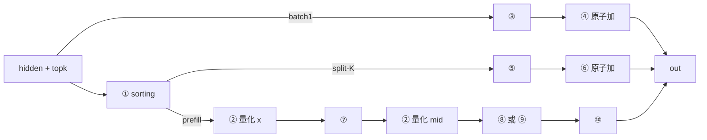

# MoE PTPC A8W4（Qwen3.8-Flash-Next，MI308X）：入口

<!-- mf:summary -->
> 由 mf 生成（11-21 15:56）· 目标：pyhip 新增 MoE 算子：bf16 激活按 token 量化成 fp8、权重 mxfp4；功能正确，decode 接近访存上限、prefill 接近算力上限（TP2/TP4 单卡形状）（1× 相对冻结基线）· 已完成 2 个里程碑（含本提交 M1） · 最佳累计 — · 下一步：M2 A8W4 prefill：fd2 解码接入 fp8 MFMA（配置表 prefill 档，当前 T≥129）
<!-- /mf:summary -->

> - **这是什么**：Qwen3.8-Flash-Next MoE（H=2560、E=512、top-10、SiLU，TP2/TP4 单卡分片）在 MI308X 上的 A8W4 ptpc 算子任务；M0 把 `moe_gemm_2stage` 换成上游 aiter `gfx9_fp8`，让 FP8 权重的 ptpc 路径（prefill 为 A8W8，decode 读 BF16 激活）经 `tuned_moe` 的 FlyDSL 候选跑通，作为后续 A8W4 的起点。
> - **为什么这样设计**：上游只覆盖 gfx942 BF16/FP8 × SiLU/SwiGLU，pyhip 还有 SiTUv2、FP4/MXFP4（gfx950）等功能和依赖内部接口的用例，所以两套并存：同名文件放上游，原实现移到 `*_legacy.py`，由 `gemm.py` 按配置分流，调用方不改。
> - **现在最大的风险**：两套实现并存，测内部细节的旧用例测的是 legacy，legacy 的 gfx950 / FP4 路径本机无法实测；M1 的 mxfp4 decode（W4A16）受延迟限制，没有因权重字节减半变快（§7），prefill 档的 A8W4 在 M2 才做。

## 1. 路线图
<!-- mf:roadmap -->
| 里程碑 | 状态 | 类型 | 标题 | 增量（预期） | 累计 | 用例 | 复核 | 提交 |
|---|---|---|---|---|---|---|---|---|
| M0 | ✅ 已推送 | 功能 | 把上游 aiter gfx9_fp8 的 kernel 更新到 pyhip moe_gemm_2stage（同名文件替换 / 更新） | — | — | ✓ | 冷读✓ 3分 | [moe-ptpc-a8w4-M0](https://github.com/luocheng25/pyhip/commit/e433e8d9184cdc5fd387641a00bc5686abec37cc) |
| M1 | ✅ 本提交 | 功能 | W4A16 decode：mxfp4 权重格式 + decode 路径（配置表 decode 档，当前 T≤128） | — | — | ✓ | ✓ | 本提交 |
| M2 | ⏳ 承诺 | 功能 | A8W4 prefill：fd2 解码接入 fp8 MFMA（配置表 prefill 档，当前 T≥129） | — | — | — | — |  |

下一步（本提交的承诺）：M2 A8W4 prefill：fd2 解码接入 fp8 MFMA（配置表 prefill 档，当前 T≥129）
<!-- /mf:roadmap -->

## 2. 性能
<!-- mf:perf -->
（尚无复核数据）
<!-- /mf:perf -->

- 验收口径（用户 11-21 确认）：每个 case 的 `latency_us` 基本达到同形状 aiter_ptpc（FP8 ptpc，A8W8）的水平，bench 里的 `aiter_ptpc` 是对照行；摘要里“decode 接近访存上限、prefill 接近算力上限”是任务方向的描述。按当前计划，基线在 M2（A8W4 prefill）完成后冻结，届时按与 aiter_ptpc 对照的实测把“1×”换算成相对 M2 基线的目标；M0 无性能主张（上面的块还没有数据）。下面几条都不是 mf 复核的数据，来源见 [深度参考 §5](m0_upstream_replacement.md#sources)。
- 替换前后（编排者复测，6 轮轮换，`runs/20261121-094917-_task-run-8e2d/out.log`）：中位比值（替换后 ÷ 替换前的耗时，6 轮的中位数，大于 1 为变慢）在默认 RTA 下 prefill（T≥1024）为 1.002–1.005，TP4 T=65536 为 0.963（改用上游 compact），decode（T≤128）为 0.988–1.023（最慢的是 TP2 T=32）；改用 RTE 则 prefill 慢 3.1–4.0%（TP4 T=65536 因同时换成 compact 为 1.003）。
- 与 aiter_ptpc 参考行相比（实现者自测，f97327ce，`runs/20261121-101211-_task-run-bebe/out.log`）：T=1024 两个 TP 都慢（1.27×、1.24×），TP2 T=32 / 128 为 1.01× / 1.03×，其余 12 个 case 更快。
- M0 验收项“`bench_tuned_moe` 替换前后对比”（编排者，[深度参考 §5](m0_upstream_replacement.md#sources)）：43 个 case 初筛 9 个慢 3% 以上，两轮复测后只剩 mimo_ptpc M=256（约 +12%，原因是 tuner 在 jit_splitk 与 aiter 之间选择翻转，用户已接受为后续事项，见 §3.6 第 4 条）；qwen35_35B M=16 三次为 1.050 / 1.066 / 1.027，贴着 3% 门槛。

## 3. 设计

### 3.1 术语
- **上游**：ROCm/aiter@df3e0b2f 的 `aiter/ops/flydsl/kernels/moe_gemm_2stage/gfx9_fp8/`，在 pyhip 里是 `moe_gemm_2stage/` 的 9 个同名文件。
- **legacy**：替换前的 pyhip 实现，原样移到 `*_legacy.py`（`gemm2_default.py` 保留原名），只给上游不支持的配置用。
- **分流**：[`gemm_implementation`](../moe_gemm_2stage/gemm.py#L39) 对一个 `compile_gemm` 配置返回 `"upstream"` 或 `"legacy"`，在按设备的编译缓存里只判定一次。
- **ptpc / A8W8 / W8A16 / A8W4**：ptpc 是 FP8（E4M3FNUZ）量化，激活每 token 一个 fp32 scale、权重每输出通道一个。A8W8 = 激活和权重都是 FP8（M0 的 prefill）；W8A16 = FP8 权重在寄存器里展开成 BF16，与 BF16 激活做 BF16 MFMA（M0 的 decode）；A8W4 = 权重换成 mxfp4（M1 起）。
- **路由 / 排序行 / 任务**：一个 (token, top-k 槽) 是一条路由；`moe_sorting` 把路由按专家排序并按 BM 补齐成排序行，每 BM 行是一个任务。
- **decode / prefill**：`tuned_moe` 的 `fly_decode`（读 BF16 激活，batch1 或 split-K）与 `fly_prefill`（两级 GEMM 的输入都按 token 量化成 FP8）；配置表里 decode 档当前是 T≤128、prefill 档是 T≥129。
- **batch1 / split-K / 1x4 / compact**：batch1 不排序，每条路由单独一组 CTA；split-K 先排序，Gate/Up 的 4 个 wave 沿 K 切分（Down 的 split-K 每个 CTA 只有 1 个 wave、不切 K，只是沿用算法名）；1x4 是 prefill 的 M64×N256 Down；compact 是任务表驱动的 M256 full（8x1，8 wave）加 M64 tail（1x4）Down。
- **BM / BN / BK 与 gm·gn·gk·dm·dn**：tile 在排序行、输出通道、归约维上的尺寸；配置里 g = Gate/Up、d = Down，如 gn128 是 Gate/Up 的 BN=128。
- **RTA / RTE**：FP32→BF16 舍入。简化 RTA = `(bits + 0x8000) >> 16`（中点远离零，可能不保留部分 NaN）；RTE = 就近偶数并保留 NaN。
- **覆盖项 id**：A 接口契约、B 分流与变体、C 边界、D 执行模式、E 数值，如 B12；逐项含义见 §4 与 [深度参考 §3–4](m0_upstream_replacement.md#routes)。

其余术语（`METADATA_TILE_SIZE_M`、full / tail 容量、padding 128 B、shuffle、`jit_*`、mimo_ptpc、fd2 解码、logits_diff、中位比值）见 [深度参考 §0](m0_upstream_replacement.md#terms)。

### 3.2 模块与接口
文件对应（`moe_gemm_2stage/`；增删行数见 [深度参考 §1](m0_upstream_replacement.md#files)）：

| 上游同名文件（生产） | 对应 legacy | 相对上游的改动 |
|---|---|---|
| `__init__.py` | — | `compile_gemm` 改从 `gemm.py` 导入（按设备缓存 + 分流），并多导出 `compile_moe_reduction` |
| `common.py` | `common_legacy.py` | aiter 依赖换成本地 `get_gfx_runtime` / `get_cu_num` / `_run_compiled`，舍入默认改为 RTA（legacy 共用） |
| `gemm1.py` | `gemm1_legacy.py` | 内容不变，原名 `_build_moe_gemm1` 指向 legacy 版 |
| `gemm2.py` | `gemm2_legacy.py`、`gemm2_default.py` | 只改 compact builder 的名字 |
| `gemm2_1x4.py` | `gemm2_1x4_legacy.py` | 不变 |
| `gemm2_8x1.py` | `gemm2_8x1_legacy.py` | 上游 builder 改名 `_upstream`（只作 compact 的 full 任务），原名指向 legacy 的独立 8x1 |
| `gemm2_8x1_compact.py` | `gemm2_8x1_compact_legacy.py` | builder 与 `allocate_task_buffers` 加 `_upstream`，原名指向 legacy 版（上游没有 K=320） |
| `moe_reduce.py` | —（pyhip 函数在同一文件末尾） | 上游 `sorted_sum` 改名 `sorted_sum_upstream` 且不用，生产用 pyhip 按设备的 `sorted_sum` 与 `invert_sorted_ids` |
| `quant.py` | — | `_run_compiled` 改从 `common.py` 导入（pyhip 内无调用方） |
| — | `gemm.py`（pyhip 独有） | 分流，并把上游 batch1 / compact 的 launcher 包装成 pyhip 调用约定 |

| 符号 | 签名 | 约束 / 报错 | 说明 |
|---|---|---|---|
| [`tuned_moe.fused_moe`](../../tuned_moe.py#L629) | aiter `fused_moe` 的参数加 `output` | 输入约束与报错见表下 | Qwen3.8 用 `per_Token` 与 `Silu`，M0 未改 |
| `pyhip.testing.moe.make_moe_runner(config)` | 固定一个 `tuned_moe` 候选 | 用例先断言 config 是 `_configs()` 会生成的候选 | 用例与 bench 用它固定 `FLY_CONFIGS`（§3.3） |
| [`compile_gemm`](../moe_gemm_2stage/gemm.py#L322) | `(N, K, weight_dtype, weight_quant_type, TOPK, BLOCK_TILE_SIZE_M, BLOCK_TILE_SIZE_N, stage, alg, E, …, has_num_local_tokens=False)` | 上游 builder 的断言；legacy 保留 pyhip 原断言与中文报错 | 返回 pyhip 调用约定的 launcher；新增的 `has_num_local_tokens=True` 例外，见表下 |
| [`gemm_implementation`](../moe_gemm_2stage/gemm.py#L39) | 同 `compile_gemm` | 不报错 | 返回 `"upstream"` / `"legacy"`，规则见下 |
| `moe_gemm_2stage.compile_moe_gemm1/2` | 上游签名 | 上游断言 | 包导出改为上游 builder（替换前是 pyhip 的），pyhip 内无调用方 |
| `moe_gemm_2stage` 包的新增导出 | `compile_gemm`、`sorted_sum`、`flydsl_absmax`、`flydsl_quant_per_tensor` | — | 替换前只导出 `compile_moe_gemm1/2` 与 `compile_moe_reduction` |
| `quant.flydsl_absmax` / `flydsl_quant_per_tensor` | 上游 | — | absmax 不再自行清零 Amax，amax=0 时输出 0（pyhip 内无调用方） |
| 环境变量 `AITER_FLYDSL_MOE_BF16_RTA_SIMPLIFIED` | 默认 `1` | 在导入 `common.py` 时读取 | 1 为简化 RTA，0 为 RTE，上游与 legacy 共用 |
| 环境变量 `AITER_FLYDSL_MOE_BF16_RTE_SIMPLIFIED` | 默认 `0` | 只在上一行设为 0（RTE）时起作用 | 1 为简化 RTE（`(bits + 0x7FFF + ((bits >> 16) & 1)) >> 16`，不保证保留 NaN），0 为保留 NaN 的 RTE（inline asm） |
| 环境变量 `MOE_PREFILL_TILE_K` | Gate/Up 的 BK | `compile_gemm` 在分流前解析 | 只作用于 Gate/Up，上游 Down 不读 |
| 环境变量 `CU_NUM` | 覆盖 CU 数 | 只改上游 `get_cu_num()` | 上游 Down 按 CU 数是否为 80 判定 MI308X |
| [`a8w4_ptpc.prepare_weights`](weights.py#L104)（M1） | `(w1, w1_scale, w2, w2_scale, *, chunk=32)` → `MXFP4Weights` | dtype 不对报 `TypeError`；维数 / 形状不一致、`H % 256 ≠ 0`、`I % 32 ≠ 0` 或 I=0、E8M0 code 255 报 `ValueError` | 加载时调用一次；输入布局见本节末尾，输出格式见 [weights.py 模块说明](weights.py#L1)；I 补零到 64 的倍数（TP4 160→192） |
| [`a8w4_ptpc.MXFP4Weights`](weights.py#L41)（M1） | frozen dataclass：`w1`、`w1_delta`、`w1_factor`、`w2`、`w2_delta`、`w2_factor`、`inter`、`inter_padded`；属性 `experts`、`hidden` | 只由 `prepare_weights` 构造 | decode（M1）与 prefill（M2）共用 |
| [`a8w4_ptpc.fused_moe`](moe.py#L66)（M1） | `(hidden_states, weights, topk_weight, topk_ids, *, output=None, config=None)` → `output` | 见本节末尾；prefill 档报 `NotImplementedError` | `Σ_k topk_weight · Down(SiLU(Gate x) · Up x)`，只有 SiLU；不调优、不回退 aiter |
| [`a8w4_ptpc.select_config`](moe.py#L27) / [`decode_max_tokens`](moe.py#L35) / [`CONFIGS`](moe.py#L19)（M1） | `select_config(tokens, configs=CONFIGS)` → 配置副本；`decode_max_tokens(configs=CONFIGS)` → decode 档上界（当前 128） | 不报错；T 超过所有上界时取最后一行 | 档位只看 `CONFIGS`，代码里不写交界 |

`fused_moe` 走本地 kernel 的输入（[`_native_kind`](../../tuned_moe.py#L40) 检查；任一条不满足就整体转交 aiter，不报错）：
- `hidden_states`：BF16 `[T, H]`，0 < T < 2^24，`H % 128 == 0`；所有张量在同一 CUDA 设备上且连续，架构为 gfx942 或 gfx950。
- `w1`：FP8 E4M3FNUZ（gfx950 上是 E4M3FN）`[E, 2I, H]`，前 I 行是 gate、后 I 行是 up；`w2`：同 dtype `[E, H, I]`；`I % 64 == 0`。两者都要经 aiter `shuffle_weight` 重排并带 `is_shuffled = True`，属性丢失时按原始布局处理，只剩 aiter 候选。
- `w1_scale` / `w2_scale`：fp32，元素数分别为 E·2I 和 E·H（用例传 `[E, rows, 1]`）。
- `topk_ids`：int32 `[T, topk]`（0 < topk < 256），`topk_weight`：fp32、同 shape；调用方保证 0 ≤ `topk_ids` < E，本地路径不检查。
- 其它参数（完整条件以 [`_native_kind`](../../tuned_moe.py#L40) L40–145 为准）：`quant_type=per_Token`；`activation` 为 Silu / Swiglu / SiTUv2，Silu 不能带 `swiglu_limit`，Swiglu 的 `swiglu_limit` 不能为 0；`gate_mode` 为 separated；`dtype` 为 None 或 BF16；张量都不 `requires_grad`；权重没有 aiter 的 padding 属性（`inter_real`、`aiter_original_k`、`aiter_padded_k`）；`expert_mask`、`num_local_tokens`、`a1_scale`、`a2_scale`、`bias1`、`bias2`、`shared_w1`、`shared_w2`、`shared_w1_scale`、`shared_w2_scale`、`stage2_scatter`、`quant_type_a`、`quant_dtype_a`、`quant_dtype_a2` 都为 None；`doweight_stage1`、`hidden_pad`、`intermediate_pad`、`splitk` 为 0 / False，`shared_expert_id=-1`，`moe_sorting_dispatch_policy=0`。
- 输出与报错：写入并返回 `output`（不传就新建），BF16 `[T, H]`；传入的 `output` 与 `hidden_states` 的 shape、dtype、device 不同或不连续时报 `RuntimeError`（[L692](../../tuned_moe.py#L692)），与任一输入内存重叠时也报 `RuntimeError`（[L698](../../tuned_moe.py#L698)）；调优时 torch 参考含 NaN / Inf（[L541](../../tuned_moe.py#L541)）、没有候选通过参考检查（L563），或在 CUDA graph capture 中触发调优（L536），同样报 `RuntimeError`。

`compile_gemm(has_num_local_tokens=True)`（M0 新增，只上游支持，pyhip 内只有用例调用）：只允许 `alg="batch1"`（[gemm1.py L59](../moe_gemm_2stage/gemm1.py#L59)、[gemm2.py L56](../moe_gemm_2stage/gemm2.py#L56) 的断言）；不做包装，原样返回上游原生 batch1 launcher（[gemm.py L315](../moe_gemm_2stage/gemm.py#L315)）：参数多一个 token 数指针 `p_num_local_tokens`，并接收路由数 T·TOPK 而不是 T；计数之后的行不计算。

dispatch（[`gemm_implementation`](../moe_gemm_2stage/gemm.py#L39) 按顺序判定，首个命中即返回；括号里是覆盖项 id，例子见 [深度参考 §3](m0_upstream_replacement.md#routes)）：
1. `has_num_local_tokens=True` → 上游（B1）；`force_batch1_path` 先把 alg 改成 batch1（B2）。
2. 非 gfx942（B3）、权重不是 bf16 / fp8（B4）、激活不是 silu / swiglu（B5）、`METADATA_TILE_SIZE_M` 不是 None 或 BM（B6）、alg 不认识（B7）→ legacy。
3. Gate/Up：带 Down 参数 → legacy（B8）；prefill_1x4 要 `N % BN == 0`、`K % (2·BK) == 0`，BF16 另要 BK ∈ {64, 128} 且 A 的 LDS ≤ 64 KiB（B9–B13）；split-K、batch1 → 上游（B14）。
4. stage 不认识 → legacy（B15）。default Down：带 padding → legacy（B16）；prefill 要 `K % 64 == 0`、`N % 256 == 0`，BF16 另查 LDS（B17、B18）；其余 → 上游（B19）。
5. 1x4 / compact Down：要 prefill、FP8、BM64（B20），padding ∈ {0, 32, 64, 128}（B21），`K % 64`、`N % 256` 为 0（B22），LDS ≤ 64 KiB（B23）；1x4 还要 BN256（B24）；compact 还要 K ∈ {192, 256, 384, 512, 640}（B25）、N ≥ 512（B26）、BN128（B27）、0 < E ≤ 2048（B28）；独立 8x1 与未知 path → legacy（B29）。

例：Qwen3.8 的全部生产配置 → 上游（B30）；Qwen3.8 TP2 若选 compact（K=320）→ legacy；SiTUv2、FP4 / MXFP4、gfx950 → legacy；`tuned_moe` 的 `8x1`（BM256）候选 → legacy。

`a8w4_ptpc` 入口（M1；输入检查在 [`_check`](moe.py#L48)，任何 kernel 启动之前完成，不满足就报错，不转交 aiter）：
- `prepare_weights` 的输入是单卡分片后的 checkpoint 自然布局：w1 uint8 `[E, 2I, H/2]`（一字节两个 E2M1，低半字节是偶数 k；前 I 行 gate、后 I 行 up），w1_scale uint8 E8M0 `[E, 2I, H/32]`；w2 `[E, H, I/2]`，w2_scale `[E, H, I/32]`；也接受 `torch.float4_e2m1fn_x2` / `torch.float8_e8m0fnu`（按字节读）。
- `fused_moe`：`weights` 不是 `MXFP4Weights` → `TypeError`；`hidden_states` 不是 BF16 `[T, H]` CUDA 张量、H 或设备与权重不符、`topk_ids` / `topk_weight` 不是 int32 / fp32 `[T, topk]`、任一张量不连续或不在同一设备、`output` 不是与 `hidden_states` 同形状的 BF16 → `ValueError`；`0 ≤ topk_ids < E` 由调用方保证，不检查。
- dispatch（[`select_config`](moe.py#L27) 查 [`CONFIGS`](moe.py#L19)）：T=0 直接返回；T=1 batch1 gn32 / dn64；2–16 batch1 gn64 / dn64（Gate/Up 顺带清零 `out`）；17–128 split-K gn128 / dn128（先调 aiter `moe_sorting`，并清零 `out`）；≥129（prefill 档）→ `NotImplementedError`（M2）。`config=` 可指定表外 tile：batch1 的 Gate/Up BN ∈ {32, 64, 128}、split-K ∈ {64, 128}，Down ∈ {64, 128}，其它值由 builder 的 `assert` 拒绝。
- 编译：[`compile_decode_gemm`](decode.py#L1115) 按设备缓存，同一设备同一配置只构建一次；decode 档可进 CUDA graph（用例在 capture 之前先调用一次完成编译）。

### 3.3 调用链
- 生产：`fused_moe` 能走本地 kernel 时，按 `batch_bucket = ceil_pow2(T)` 和 `model_key`（形状、dtype、布局、设备、环境变量）自动调优（[L576–579](../../tuned_moe.py#L576)）；候选（[`_configs`](../../tuned_moe.py#L148)）有 aiter、ASM `jit_*`、FlyDSL `fly_decode`（batch1 只在桶 ≤ 32）和 `fly_prefill`（桶 ≥ 64），在 torch 参考上 `calc_diff` ≤ 0.02 的候选里取最快的并缓存，胜出的不一定是 FlyDSL。
- 用例与 bench：[`FLY_CONFIGS`](../../../../testing/moe_a8w4_ptpc.py#L41) 经 `make_moe_runner` 强制走 FlyDSL，两级都判给上游（B30）：T=1 batch1 gn32；2–16 batch1 gn64；17–128 split-K；129–1024 prefill 1x4（TP2 gk128、TP4 gk256）；1025–8192 1x4 gk256；>8192 TP2 1x4 gk256、TP4 compact gk256（全表见 [深度参考 §0](m0_upstream_replacement.md#configs)）。交界当前是 128/129，M1、M2 跟随配置表：decode 档用 W4A16、prefill 档用 A8W4，调优后可能移动（用户 11-21 确认）。

| # | kernel | grid×block，LDS | 作用 |
|---|---|---|---|
| ① | `moe_sorting`（aiter） | aiter 自定 | 排序路由、按 BM 补齐，并清零 `out`（batch1 不用） |
| ② | 按 token 量化（aiter `get_hip_quant`） | aiter 自定 | prefill 时把 `x`、`mid` 各量化成 FP8 |
| ③ | [`moe_2stage_gateup_batch1`](../moe_gemm_2stage/gemm1.py#L746) | (N/BN, 10, T)×256，16 KiB | 一条路由 × BN 列，4 个 wave 沿 K 切分，顺带清零 `out` |
| ④ | [`moe_2stage_down_batch1`](../moe_gemm_2stage/gemm2.py#L293) | (2560/64, 10, T)×64，无 | 一条路由 × 64 列，BF16 原子加到 `out` |
| ⑤ | [`moe_2stage_gateup_splitk`](../moe_gemm_2stage/gemm1.py#L633) | (N/128, 任务数)×256，16 KiB | 16 排序行 × 128 列，4 个 wave 沿 K 切分 |
| ⑥ | [`moe_2stage_down_splitk`](../moe_gemm_2stage/gemm2.py#L156) | (2560/128, 任务数)×64，1 KiB | 16 排序行 × 128 列，原子加到 `out` |
| ⑦ | [`moe_2stage_gateup_prefill_1x4`](../moe_gemm_2stage/gemm1.py#L856) | (N/128, 任务数)×256，16 / 32 KiB（gk128 / gk256） | 主 kernel：64 排序行 × 64 对 gate/up 通道，写 BF16 `mid` |
| ⑧ | [`moe_2stage_down_prefill_1x4_64x256`](../moe_gemm_2stage/gemm2_1x4.py#L227) | (1, 任务数)×256，TP2 29 KiB / TP4 21 KiB | 64 排序行 × 全部 2560 列，写按排序行排列的中间结果 |
| ⑨ | compact：[任务表](../moe_gemm_2stage/gemm2_8x1_compact.py#L55) → [8x1 full](../moe_gemm_2stage/gemm2_8x1.py#L719) → 1x4 tail | (1)×256，8 KiB → (1, full 容量)×512，64 KiB → (1, tail 容量)×256，21 KiB | TP4 T>8192 时代替 ⑧ |
| ⑩ | [`invert_sorted_ids`](../moe_gemm_2stage/moe_reduce.py#L215) → `sorted_sum`（pyhip） | (⌈排序行/64⌉)×64 → (T)×64，无 | 把每个 token 的 10 条路由求和写 `out` |

③–⑥ 在寄存器里把 FP8 权重展开成 BF16，再与 BF16 激活做 BF16 MFMA 16×16×16，即 W8A16（[common.py L949](../moe_gemm_2stage/common.py#L949)）；⑦⑧ 和 ⑨ 的 full / tail kernel 做 FP8 MFMA 16×16×32。N = 2·I（TP2 640、TP4 384；TP4 的 I=160 在加载权重时补零到 192，因为 Down 要 I % 64 == 0，C3）；任务数默认是排序后 BM 块的上限（越界的块直接返回），⑤⑥⑦ 在 M·TOPK ≤ E 时改为 M·TOPK（Qwen3.8 只在 T ≤ 51 时）。



### 3.4 tile 划分
主 kernel ⑦ Gate/Up prefill_1x4（Qwen3.8 配置 gm64 gn128，gk128 或 256；K = H = 2560）：

| 层级 | 形状 | 负责的数据 |
|---|---|---|
| CTA（256 线程 = 4 wave） | 64 排序行 × 128 列 × 全部 K | 一个任务的一组 64 个中间通道，输出 `mid` 的 64 行 × 64 通道 |
| wave | 16 个 gate 加 16 个 up 通道 × 64 行 | MFMA 的 M 维是权重通道（4 个 wave 沿通道并排），N 维是排序行 |
| lane | MFMA 16×16×32 FP8，每个 16×16 块 4 个 fp32 | gate、up 各 4 块（64 行 ÷ 16），各 16 个 fp32 累加器 |
| K 步 | BK = 128 或 256，共 K/BK = 20 或 10 步（必须为偶数） | A（激活）经 LDS ping / pong，B（权重）从 global 直接进寄存器双槽 |

`blockIdx.y` 选任务（同一专家的 64 个排序行），`blockIdx.x` 选通道组：gate 的 64 列加对应 up 的 64 列；A 按排序行 gather。

⑧ Down 1x4：CTA 是 64 排序行 × 256 列一块，沿 N 循环 2560/256 = 10 块，K（TP2 320、TP4 192）一次全部 gather 进 LDS；wave 负责 64 列 × 64 行；lane 持有 16 个 16×16 块 × 4 = 64 个 fp32；BK 在 K % 128 == 0 时为 128，否则 64（TP2 5 步、TP4 3 步）。

### 3.5 流水线伪代码
⑦ 的代码：[kernel](../moe_gemm_2stage/gemm1.py#L856)、[`gemm_1x4`](../moe_gemm_2stage/gemm1.py#L310)、[`pipeline_stage`](../moe_gemm_2stage/gemm1.py#L481)、[`hot_loop_scheduler`](../moe_gemm_2stage/gemm1.py#L454)、[主循环](../moe_gemm_2stage/gemm1.py#L529)、[SiLU 与舍入](../moe_gemm_2stage/gemm1.py#L241)、[CShuffle 写回](../moe_gemm_2stage/gemm1.py#L1011)。
```text
if blockIdx.y * BM >= num_valid: return                       # L883 越界任务直接返回
sorted_lds[0:BM] ← 本任务的 sorted_ids; barrier                 # L908
gemm_1x4():                                                    # L310
  A 的行索引 ← sorted_lds; barrier（之后 a_ping 复用这块 LDS）     # L355–L367
  # prologue
  A[k0]：按排序行 gather，global→寄存器；B_gate / B_up[k0]：global→寄存器槽 0   # L520
  s_waitcnt(vmcnt=0); A 寄存器→LDS ping; barrier                 # L523–L525
  # 主循环：每轮两拍，先读 ping 写 pong，再反过来
  for iv in range(K/BK/2 - 1):                                 # L529
      stage(read=0, next=2·iv+1); stage(read=1, next=2·iv+2)
  stage(read=0, next=最后一步); stage(read=1, 不预取)              # L538–L540
stage(read, next):                                             # L481
  发起 A[next]、B_gate / B_up[next] 的 global 读（VMEM，与本拍 MFMA 重叠；B 进槽 1-read）
  for ki in range(BK/64):
      A[read] LDS→寄存器; gate、up 各 2 次 K32 MFMA × 4 个行块
  A[next] 寄存器→LDS[1-read]                                    # L515
  hot_loop_scheduler：交错 ds_read / VMEM / MFMA / ds_write      # L454
  sched_barrier; barrier（下一拍才读刚写进 LDS 的 A）               # L517–L518
# epilogue
反量化：× w_scale[通道] × a_scale[token]                         # L971
SiLU(gate)·up → BF16（_f32_to_bf16，默认 RTA）                   # L984 → L275
barrier; BF16 写进 LDS（复用 a_ping）做 CShuffle; barrier; 128b 读回   # L1011–L1020
按排序行写 mid[token, top-k 槽, 通道]                             # L1021
```
主循环里没有显式 `s_waitcnt`：A[next] 写 LDS 之前、下一拍用 B 之前的 vmcnt 等待由编译器按数据依赖插入；写 LDS 与 `hot_loop_scheduler` 只在有预取的拍执行。

⑧ 的代码：[kernel](../moe_gemm_2stage/gemm2_1x4.py#L227)、[gather](../moe_gemm_2stage/gemm2_1x4.py#L34)、[K 步](../moe_gemm_2stage/gemm2_1x4.py#L554)、[N 循环](../moe_gemm_2stage/gemm2_1x4.py#L596)。
```text
e = _map_down_task()：任务号在 XCD 间交错；越界返回                  # L241
A[64 行, 全部 K] ← 按排序行 gather FP8 中间激活进 LDS; barrier       # L326（L34）
行系数 = 路由权重 × 激活的 token scale
prologue：B[n0, k0] global→寄存器槽 0；ptpc 时 w_scale[n0] 进 LDS    # L531
for n in range(2560/256):          # scf.for，循环携带下一块的 B 与 scale   # L596
    fragC = 0
    for k in range(K/BK):          # TP2 5 步、TP4 3 步（BK=64）        # L608
        A[k] LDS→寄存器；预取下一个 (n, k) 的 B 到另一槽（换 n 时也取 w_scale）
        MFMA fragC += B·A（优先级 3）                                   # L578
    fragC × w_scale[通道] × 行系数 → BF16                               # L613–L618
    每个 wave 经 16×64 BF16 的 LDS 做 CShuffle，写这 64 行的 256 列     # L619
```
BK=128 且只有 2 个 K 步时，上一块的写回会与下一块的 K 步重叠（[L529](../moe_gemm_2stage/gemm2_1x4.py#L529)）；Qwen3.8 的 K 不走这条。

### 3.6 已知限制
1. 两套实现并存：包内 `*.py` 由 8006 行增到 14158 行；只有上游不支持的配置走 legacy，修 bug 可能要改两处。
2. 测内部细节的旧用例（8x1 闭包变量、compact 签名、legacy 报错文本）测的是 legacy；上游 kernel 除 U、Q 外，也由 TM 的 `test_fly_decode`、`test_fly_direct`、`test_fly_swiglu`、`test_fly_down_paths` 和 TT 的 `test_fly_direct_clear_graph` 覆盖（gfx942 上 bf16 / ptpc / per_tensor × SiLU / SwiGLU 判给上游）。
3. gfx950、FP4 / MXFP4、SiTUv2 全走 legacy、代码未改：SiTUv2 的 bf16 / ptpc 用例在 gfx942 上会跑（B31）；FP4 / MXFP4 与 gfx950 的用例本机跳过（B32），无法实测。
4. `tuned_moe` 调优不稳：mimo_ptpc（见 [深度参考 §0](m0_upstream_replacement.md#terms)）M=256 经 `tuned_moe` 端到端慢 12%（初筛 1.136、复测 1.119），胜出配置从 ASM `jit_splitk` 换成 aiter；两边用同一调优配置时为 1.007。用户 11-21 决定接受：非替换造成，M0 不处理，记为 tuned_moe 调优不稳（调优测量与正式计时不一致）的后续事项。出处（编排者）：`runs/20261121-104005-_task-run-7733/out.log`（筛查）、`runs/20261121-104604-_task-run-af22/out.log`（复测）、`runs/20261121-105710-_task-run-57d8/out.log`（同一调优配置）。
5. 正确性命令排除 9 个替换前就失败的用例：`test_asm_batch_loopn` 8 个（ASM JIT 缓存文件名含 worktree 长路径，Errno 36）和 `test_aiter_signature` 1 个（/opt/aiter 的 `fused_moe` 多 3 个参数）。
6. 运行时仍依赖 aiter：`tuned_moe` 的排序、激活量化和 `_run_compiled`；kernel 文件本身不导入 aiter（A10）。
7. TP4 补零在权重加载侧（`make_weights`）做，算子本身不补；未补零的 I=160 在 `tuned_moe` 里没有本地候选，只走 aiter。
8. BF16 舍入默认 RTA，偏离上游的 RTE：中点差 1 个 BF16 ulp，简化 RTA 可能不保留部分 NaN；开关在导入 `common.py` 时读取，进程内再改环境变量不生效。
9. 替换带来的行为差异：`MOE_PREFILL_TILE_K` 不再作用于上游 Down；`CU_NUM` 会改变上游 Down 对 MI308X 拓扑的判断；`has_num_local_tokens` 只有用例在用。
10. 文档：`moe_gemm_2stage/README.md` 的性能与资源数字是替换前 legacy 实现的测量；`tests/ops/moe/README.md` 的 a8w4_ptpc 段已过时（没有 T=65536、没提新用例），M1 时更新（M1 已更新）。

## 4. 测试
用例前缀：`U` = [a8w4_ptpc/test_moe_gemm_2stage_upstream.py](../../../../../../tests/ops/moe/a8w4_ptpc/test_moe_gemm_2stage_upstream.py)（94 个，只构建 launcher 或编译小 kernel），`Q` = [a8w4_ptpc/test_qwen38_ptpc.py](../../../../../../tests/ops/moe/a8w4_ptpc/test_qwen38_ptpc.py)（34 个，Qwen3.8 端到端），`TM` = `tests/ops/moe/test_moe.py`，`TT` = `tests/ops/moe/test_tuned_moe.py`（TM、TT 本里程碑未改）。`U::routes[x]` = `test_compile_gemm_routes[x]`，`U::adapt[x]` = `test_compile_gemm_adapts_launchers[x]`。覆盖项共 63 个，逐项见 [深度参考 §4](m0_upstream_replacement.md#coverage)。

| 类别 | 用例 | 覆盖项 | 说明 |
|---|---|---|---|
| 分流 | U::routes（68 个） | B1–B29、C4 | 每条规则至少一例（多数规则两侧各一例），断言判定结果、实际调用的 builder，以及上游 builder 能否构建 |
| 适配 | U::adapt（12 个） | A1、A2、A4、A5 | batch1 / compact 包装的闭包、签名、compile_hints 与 `cu_count`；其余出口原样返回 |
| 缓存与环境 | U::test_compile_gemm_routes_once_per_device、test_compile_gemm_prefill_tile_k_env、test_chip_info_stand_ins | D1、A13、A11 | 每设备只判定一次；TILE_K 只作用于 Gate/Up；`CU_NUM` 与非 gfx942 报错 |
| 符号与依赖 | U::test_pyhip_symbols_keep_their_modules、test_kernel_modules_import_without_aiter、test_run_compiled_compiles_once_and_recovers | A7–A10、D4 | 原名符号还在原模块；屏蔽 aiter 后能导入；编译失败后可恢复 |
| compact 容量 | U::test_compact_task_buffers_match_upstream_split | A3、C5 | pyhip 分配的任务缓冲与上游按同一 CU 数的拆分容量相等 |
| 舍入与量化 | U::test_bf16_rounding_switch（4 个）、test_f32_to_bf16_follows_switch（2 个）、test_flydsl_quant_per_tensor_contract | E2、E3、A12、E6、C6 | 开关默认 RTA、0 为 RTE；逐位位型；absmax 不清零、amax=0 输出 0 |
| 端到端 | Q::test_matches_reference（25 个） | B30、C1–C3、E1 | TP2 / TP4 × T ∈ {1, 8, 16, 32, 128, 129, 256, 257, 1024, 2000, 8192, 65536}，TP4 另加 8200；对 FP32 参考，并断言两级都判给上游、alg 与 Down path 就是配置表这一档 |
| graph 与 RTE | Q::test_decode_cuda_graph（4 个）、test_rte_rounding_matches_reference（4 个）、test_num_local_tokens_skips_padding_rows | D2、E4、A6、D3 | decode 三种配置 replay 新输入；RTE 下同一参考与容差；计数之后的行不写 |
| 现有用例·上游 | TM::test_fly_decode、test_fly_direct、test_fly_swiglu、test_fly_down_paths（default / 1x4 / compact），TT::test_fly_direct_clear_graph 等 | A1、A7、D5、D6、E5 | gfx942 上 bf16 / ptpc / per_tensor × SiLU / SwiGLU 判给上游，用小形状对 torch 参考（`calc_diff` ≤ 0.02）；两卡用例本机跳过 |
| 现有用例·legacy | TM::test_fly_situv2_*、test_fly_down_paths（8x1、compact K=320）、test_fly_down_8x1_* 等，TT 的报错文本用例 | B31、B32 | SiTUv2、独立 8x1、compact K=320、METADATA≠BM、legacy 报错文本；FP4 / gfx950 用例本机跳过 |
| 性能 | [bench_moe_a8w4_ptpc.py](../../../../../../benchmarks/moe/bench_moe_a8w4_ptpc.py) `--mf` | — | TP2 / TP4 × T ∈ {1, 8, 16, 32, 128, 1024, 8192, 65536} 共 16 个 case，覆盖 batch1、split-K、1x4 gk128 / 256、compact；`aiter_ptpc` 为参考行 |

- Q 的容差沿用上游 aiter `op_tests/test_flydsl_moe_gfx942.py`：逐元素偏差不超过该 token 参考值 RMS 的 1 倍、`logits_diff` < 1e-3（`1 − 2·Σxy / Σ(x² + y²)`，与 `calc_diff` 同一公式）、最差 token 的相对 L2 误差 < 0.2（[`check_output`](../../../../testing/moe_a8w4_ptpc.py#L253)）。
- 最先失败的用例：正确性命令按 test_moe → test_tuned_moe → a8w4_ptpc 的顺序跑（带 `-x`）。改坏上游 kernel 的数值时，最先失败的是 TM 里走上游的 `test_fly_decode`（split-K）、`test_fly_direct`（batch1）、`test_fly_swiglu`、`test_fly_down_paths`；只跑 a8w4_ptpc，或误差小到 `calc_diff` ≤ 0.02 抓不到时，才由 Q::test_matches_reference 先发现。改坏分流或适配层时，U::routes / U::adapt 直接定位到出错的规则（U 文件不跑 kernel 主体，测试负责人实测约 8 s）。测试负责人在源码临时副本上做了 22 处变异，全部被新用例检出。
- M0：task.json 的正确性命令在最终状态为 1344 通过 / 733 跳过 / 191 deselected（测试负责人，`runs/20261121-132445-_task-run-0738`）。

**M1（W4A16 decode）覆盖**：前缀 `D` = [a8w4_ptpc/test_a8w4_decode.py](../../../../../../tests/ops/moe/a8w4_ptpc/test_a8w4_decode.py)（18 个，实现者），`DE` = [a8w4_ptpc/test_a8w4_decode_edges.py](../../../../../../tests/ops/moe/a8w4_ptpc/test_a8w4_decode_edges.py)（12 个，复核补充）。GPU 用例的参考是 mxfp4 精确反量化（施加同一 flush 规则）、BF16 激活、FP32 计算（[`moe_a8w4_mxfp4.reference_moe`](../../../../testing/moe_a8w4_mxfp4.py#L90)），容差是上面 M0 的 `check_output`，未放宽。

| 情况 | 用例 | 类型 | 结果 |
|---|---|---|---|
| prepare 逐位：解回的权重 = 反量化 + flush + 补零（CPU，E=2、H=256、I=96 补到 128） | D::test_prepare_matches_dequant_bitwise | 功能 | 通过 |
| prepare 字节：fd1 nibble 顺序、−0 改 +0、flush 整组置 0、delta 字节（d=0..11，d=12 记 88）、因子（c_max 0 / 5 次正规数、6、200、254） | D::test_prepare_byte_layout | 功能 | 通过 |
| prepare 报错与 dtype：code 255（w1 / w2 的 scale）、形状不一致、2I 为奇数、维数、`H % 256`、`I % 32`、int16 → `TypeError`；fp4x2 / e8m0 dtype 与 uint8 结果相同 | D::test_prepare_rejects_invalid、DE::test_prepare_rejects_other_invalid | 功能 | 通过 |
| prepare 按专家分块（chunk=1、2，最后一块不满）结果不变 | DE::test_prepare_chunk_does_not_change_result | 功能 | 通过 |
| 配置表查表：decode 各行上下界、上界 + 1 进 prefill、超过所有上界取最后一行、返回副本 | DE::test_select_config_rules | 功能 | 通过 |
| decode 端到端：TP2 / TP4 × T ∈ {1, 8, 16, 32, 128}（各档上界与档内值），断言实际编译的两级 kernel 就是配置表这一档 | D::test_decode_matches_reference（10 个） | 功能 | 通过 |
| 各档下界（交界另一侧）：TP2 / TP4 × T ∈ {2, 17}；TP4 不传 `output`（新建输出） | DE::test_decode_tier_lower_edges（4 个） | 功能 | 通过 |
| 配置表以外的 tile（`config=`）：TP4 T=8 batch1 gn128 / dn128，TP2 T=32 split-K gn64 / dn64（delta 选择的其余分支） | DE::test_config_override_tiles（2 个） | 功能 | 通过 |
| prefill 档（decode 上界 + 1，当前 129）报 `NotImplementedError`，不写输出 | D::test_prefill_tier_not_implemented | 功能 | 通过 |
| 输入检查：16 种非法输入在启动前报错（`output` 保持 NaN、未编译） | DE::test_fused_moe_rejects_invalid_inputs | 功能 | 通过 |
| 空输入 T=0：不编译、不启动，返回 `[0, H]` | DE::test_empty_input_returns_without_launch | 功能 | 通过 |
| CUDA graph：batch1 gn32（TP2 T=1）、batch1 gn64（TP4 T=8）、split-K（TP2 T=32、TP4 T=128）各捕获一次，replay 两组新输入与路由 | D::test_decode_cuda_graph（4 个） | 功能 | 通过 |
| 编译缓存：同一设备同一配置只构建一次，换设备 key 重新构建；BM ≠ 16 被断言拒绝 | DE::test_compile_decode_gemm_cached_per_device | 功能 | 通过 |
| BF16 舍入切到 RTE（`AITER_FLYDSL_MOE_BF16_RTA_SIMPLIFIED=0`） | D、DE 全部 30 个 | 功能 | 通过（复核，`runs/20261121-154820-_task-run-7842`） |
| 性能：a8w4 的 TP2 / TP4 × T ∈ {1, 8, 16, 32, 128}（batch1 gn32 / gn64、split-K 三个 regime），graph 计时，`fly_ptpc`（M0 FP8）与 `aiter_ptpc` 为对照行 | bench_moe_a8w4_ptpc.py `--mf --check` | 性能 | a8w4 ÷ fly_ptpc 为 0.979–1.307，几何平均 1.069；a8w4 对 FP32 参考 logits_diff ≤ 8.8e-6（实现者自测，`runs/20261121-150631-_task-run-5bce`） |
| 全部功能用例（含 M0 的 TM、TT、U、Q） | task.json 正确性命令 | 功能 | 1374 通过 / 733 跳过 / 191 deselected（复核，`runs/20261121-154453-_task-run-213c`；实现者提交时为 1362，加上 DE 的 12 个） |

**M1 未覆盖 / 跳过**：
- flush 对真实权重的影响没统计：本机没有 Qwen3.8 的 mxfp4 checkpoint，d ≥ 12 被置 0 的组占多少未知。
- 测试权重是随机 nibble（16 个编码均匀，含 −0）和随机组 code（行基准 118–124 再减 0–20），不是按 OCP 规则量化的 BF16。
- kernel 在寄存器里的 fp4 解码没有单独的逐位用例：逐位只验证到 `decode_prepared`（按 kernel 算术写的 Python 模型），kernel 本身由端到端容差间接验证。
- 只测 Qwen3.8 形状（H=2560、E=512、topk=10、I=320 / 160→192）；其它 H、topk、E 只在 CPU 的 prepare 小形状上出现。
- `topk_ids` 越界（≥ E 或负数）不检查、未测；多卡上的编译缓存只用替换设备 key 模拟；非 gfx942 跳过；prefill 档只测报错（M2 实现）。
- 冗余（不删）：DE::test_select_config_rules 的上界检查与 D::test_decode_matches_reference 里的 `select_config` 断言部分重复。

```bash
python -m pytest -q tests/ops/moe/a8w4_ptpc                                         # 本任务的 158 个用例（M0 128 个 + M1 30 个）
python -m pytest -q tests/ops/moe/a8w4_ptpc/test_moe_gemm_2stage_upstream.py        # 只测分流与适配
python -m pytest -q tests/ops/moe/a8w4_ptpc/test_a8w4_decode.py tests/ops/moe/a8w4_ptpc/test_a8w4_decode_edges.py  # 只测 M1 的 A8W4 decode（约 30 s）
AITER_FLYDSL_MOE_BF16_RTA_SIMPLIFIED=0 python -m pytest -q tests/ops/moe/a8w4_ptpc  # RTE 下复跑
python benchmarks/moe/bench_moe_a8w4_ptpc.py --mf                                   # 性能：MF_METRIC / REF 行
```

## 5. 决策与死路
- 死路（M0，11-21 用户）：旧 M0 新建 `gfx9_fp8` 子目录和独立 host，方向错误；撤销重做，旧提交 4a4b5ed481 不保留。
- M0：两套并存（用户选 A）；没选“合并进上游结构”（2–4 天、FP4 / gfx950 本机无法验证）和“纯上游”（要删改约 55 个受保护用例，并去掉 MI355 上的 FlyDSL FP4 / SiTUv2）。
- M0：不另建 host，FP8 ptpc 走现有 `tuned_moe` 的 FlyDSL 候选；用例与 bench 用 `make_moe_runner` 固定配置。
- M0：沿用 pyhip 对 aiter 的依赖（排序、激活量化）；kernel 文件不再 import aiter，换成 `common.py` 里的本地实现。
- M0：BF16 舍入默认保持 pyhip 的简化 RTA（用户 11-21 决定）。依据：上游默认 RTE，编排者 6 轮复测 RTE 让 prefill 慢 3.1–4.0%、RTA 与替换前持平（§2）；两种模式只在中点差 1 个 BF16 ulp，都满足同一参考与容差（E4）；legacy 与上游共用 `AITER_FLYDSL_MOE_BF16_RTA_SIMPLIFIED`，设 0 切回 RTE。
- M0：`gemm2_default.py` 保留原名作 legacy（计划原写删除）：legacy 的 Down 分发和 legacy compact 的 N128 尾块仍用它。
- M0：配置表只取分流到上游的候选；替换后重扫，TP4 T>8192 改用上游 compact（实现者扫描比 1x4 快 3–4%）；TP2 T=8192 最快的是 legacy compact K=320（约快 1%），不取。
- M0：`moe_gemm_2stage/README.md` 只更新替换相关部分（文件对应、接口变化、过期章节标注），不重写。
- M0（11-21 用户）：接受 mimo_ptpc M=256 经 `tuned_moe` 端到端慢 12%——非替换造成（两边用同一调优配置时 1.007），M0 不处理，记为 tuned_moe 调优不稳（调优测量与正式计时不一致）的后续事项（§3.6 第 4 条）。
- M1、M2（11-21 用户；都是功能里程碑，计划里不承诺性能）：decode 档保持 BF16 激活、mxfp4 权重精确展开成 BF16（W4A16）；prefill 档激活按 token 量化成 FP8、mxfp4 经 fd2 解码成 FP8（A8W4）；中间结果按 token 量化。交界跟随配置表，当前为 T=128/129（decode 档 T≤128，prefill 档 T≥129），由调优决定，M1、M2 调优后可能移动（用户 11-21 确认）。依据：沿用 M0 各档的数据流（decode 读 BF16 激活，prefill 两级输入按 token 量化成 FP8），只把 FP8 权重换成 mxfp4；gfx942 没有 FP4 MFMA，prefill 先解码成 FP8 再走 FP8 MFMA。
- M1：w1 字节排列暂不改，M1、M2 沿用 fd2 排列（编排者在用户 11-21 授权期内按默认值决定，记为性能阶段假设 H1）；fp4 展开用 PR #64 的 fd2 查表，没用上游 a16wmix 的 A16W4 解码；split-K 仍用 aiter `moe_sorting`（沿用 M0 的用户决定）。见 §7。

## 6. 深度参考
- [M0 深度参考](m0_upstream_replacement.md)：补充术语与 Qwen3.8 配置全表、逐文件相对上游的改动、与上游的行为差异、分流规则全表（B1–B29）、覆盖项全表（63 项）、测量来源。
- [moe_gemm_2stage/README.md](../moe_gemm_2stage/README.md)：替换前 pyhip 实现（现为 legacy）的 8x1 / compact 流水线与历史性能、资源；顶部有替换状态和过期章节标注。
- [benchmarks/moe/README.md](../../../../../../benchmarks/moe/README.md)：`bench_moe_a8w4_ptpc.py` 的计时协议。
- M1 的权重格式（fd2：nibble、delta、因子的布局与精确性论证）：[weights.py 模块说明](weights.py#L1)；W4A16 kernel 相对上游的改动：[decode.py 文件头](decode.py#L1)。
- 原始数据在 myflow 任务目录（不在仓库）：`runs/20261121-094917-_task-run-8e2d/out.log`（替换前后与 RTE / RTA 轮换）、`runs/20261121-104005-_task-run-7733/out.log`、`runs/20261121-104604-_task-run-af22/out.log`、`runs/20261121-105710-_task-run-57d8/out.log`（`bench_tuned_moe` 筛查、复测、同一调优配置复测）、`runs/20261121-101211-_task-run-bebe/out.log`（实现者 bench 自测）。M1：`runs/20261121-150631-_task-run-5bce/out.log`（实现者 bench `--mf --check`）、`runs/20261121-151652-_task-run-6b75/out.log`（预热时长对比）、`runs/20261121-151331-_task-run-ebce/out.log`（profiler 分 kernel 计时）、`runs/20261121-151434-_task-run-bd4c/out.log`（10 种 decode tile 扫描）、`runs/20261121-154453-_task-run-213c/out.log`（复核跑的正确性命令）。

## 7. 里程碑（最新在上）

### M1 · W4A16 decode：mxfp4 权重格式 + decode 档（配置表 decode 档，当前 T≤128）
**做了什么**
- [`prepare_weights`](weights.py#L104)：checkpoint 自然布局的 mxfp4（E2M1 + 每 32 个 K 一个 E8M0）→ [`MXFP4Weights`](weights.py#L41)（PR #64 的 fd2 格式：fd1 排列的 nibble、每组一个 delta 字节、每通道一个 fp32 因子），加载时做一次，M2 的 prefill 沿用同一份。
- [`decode.py`](decode.py#L1)：由上游 gfx9_fp8 的 `gemm_splitk`（common.py）与 `moe_2stage_{gateup,down}_{splitk,batch1}`（gemm1.py / gemm2.py）派生 4 个 W4A16 kernel 和按设备缓存的 [`compile_decode_gemm`](decode.py#L1115)，只改 B 的读取与 fp4 展开；`moe_gemm_2stage/`、`tuned_moe` 未改。
- [`fused_moe`](moe.py#L66)：按 [`CONFIGS`](moe.py#L19) 分档，decode 行沿用 M0（T=1 batch1 gn32，2–16 batch1 gn64，17–128 split-K），prefill 档报 `NotImplementedError`（§3.2）。另加 `pyhip.testing.moe_a8w4_mxfp4`（随机 mxfp4、精确反量化、FP32 参考）、bench 的 `a8w4` 实现、30 个用例（§4）。

**为什么**
- 用户 11-21 选 A：decode 沿用 M0 的数据流（BF16 激活，权重在寄存器里展开成 BF16 做 BF16 MFMA），只把 FP8 权重换成 mxfp4；fd2 让 decode 与 M2 的 prefill 共用同一份字节和同一张查找表。
- 精确：c_max 取该通道各组 E8M0 的最大值，查表值 |E2M1|·2^(5−d)（d = c_max − code ≤ 11）都是 FP8 E4M3FNUZ 正规数，FP8→BF16 也精确；epilogue 乘因子 2^(c_max−132)（2 的幂）得 E2M1·2^(code−127)。所以 kernel 用的权重与“mxfp4 反量化 + flush（d ≥ 12 的组置 0）”逐位相同（§4 的 prepare 逐位用例）。
- 输出不逐位（中间结果存 BF16、FP32 累加顺序不同），对 FP32 参考满足 M0 容差（logits_diff < 1e-3，实测 ≤ 8.8e-6）。没变快是因为每 lane 每轮 B 的在途字节由 16 B 减到 8 B，decode 受延迟限制（见已知问题）。

kernel（`gemm_splitk`，四个 kernel 共用；`[M1]` 标出相对 M0 decode kernel 的改动）：
```text
# decode.py L119（M0：moe_gemm_2stage/common.py L919）。Gate/Up 4 个 wave 沿 K 切分、每轮 256 K；Down 1 个 wave、每轮 64 K
setup：A 不变（BufferCopy128b；split-K 按排序行 gather）
  [M1] B：权重看成 (N, K/8) 的 dword，每 lane 每个 N repeat 读 dwordx2 = 16 个 K 的 nibble       # L79–L117（M0：dwordx4 = 16 个 FP8）
  [M1] 断言 lane l 读 K 的 [16·⌊l/16⌋, +16)：这 16 个 K 在同一 32-K 组，只需一个 delta            # L101–L102
  [M1] delta：每个用到的 64 行块每轮读 1 个 dword（4 个 16 行块的 delta 字节）                    # L61、L481、L834
prefetch(k, buf)：A[k] → a_frag[buf]；B[k] → b_raw[buf]；[M1] delta[k] → d_frag[buf]            # L229–L232
vmcnt_per_prefetch = A 的条数 + B 的条数 + [M1] delta 的条数                                    # L257–L260
prefetch(0, 0)
for k2 in range(num_k_iters // 2):                                                          # L265
    prefetch(2·k2+1, 1); s_waitcnt(vmcnt_per_prefetch); sched_barrier
    decode_b(0); MFMA 16×16×16 BF16：c += B·A; sched_barrier                                  # L272
    prefetch(2·k2+2, 0); s_waitcnt(vmcnt_per_prefetch); sched_barrier
    decode_b(1); MFMA; sched_barrier                                                         # L279
num_k_iters 为奇数时补一次 decode_b(0) + MFMA                                                  # L286
[M1] decode_b(buf)（M0 只有最后一行）：                                                          # L234–L250
    for 每个 N repeat:
        d  = v_perm 把这一行这一组的 delta 字节 min(c_max−code, 11)·8 广播到 4 个字节
        lo = (0x6C686080 − d) & 0xFFFFFF00;  hi = 0x7C787470 − d     # |E2M1|·2^5 的 FP8 表整体减 d，0 号保持 0
        for 2 个 dword（各 8 个 fd1 nibble）:
            k0..3、k4..7 = v_perm(hi, lo, nibble & 7) | 符号位 → 2 个 FP8 dword                 # L49
    _cvt_fp8_bf16(FP8 → b_frag[buf])          # 与 M0 相同：v_cvt_pk_f32_fp8 再取高 16 位
Gate/Up 的 K 方向归约（batch1、split-K 都有）：4 个 wave 的部分和写 LDS；barrier；求和；barrier —— 与 M0 相同   # L289–L394
epilogue：c × 每通道因子（[M1] 传 2^(c_max−132)，与 M0 的 w_scale 同位置）→ Gate/Up：SiLU·up → BF16 写 mid；
          Down：× 路由权重 → BF16 原子加到 out —— 与 M0 相同                                    # L423、L805
```

**与计划 / 上游的差异**
- 计划写“测试权重按 OCP 规则量化 BF16”→ 实际是随机 nibble 与随机组 code（覆盖 d=0..11 与 flush），见 §4 未覆盖清单（编排者在用户授权期内按默认值追认）。
- bench：decode 档的 graph 计时改为跟 a8w4 配置表（T≤128，原 T≤32），`fly_ptpc` / `aiter_ptpc` 的 T=128 也改用 graph，与 M0 的 T=128 数字口径不同；默认 `--impl a8w4,fly_ptpc,aiter_ptpc`，prefill case 跳过 a8w4，`--impl fly_ptpc,aiter_ptpc` 恢复 M0 行为（编排者在用户授权期内按默认值追认）。
- SPEC §5 写“算子运行时不依赖 aiter”：split-K 仍调 aiter `moe_sorting`（kernel 文件不导入 aiter），按用户 11-21 在 M0 重做时的决定（沿用 pyhip 对 aiter 的排序、激活量化依赖）。
- w1 字节排列不改（每 lane 每轮读 16 B / 32 K 才能吃到字节减半）：编排者在用户授权期内按默认值决定 M1、M2 沿用 fd2 排列，记为性能阶段假设 H1。
- 上游 aiter `moe_2stage_a16wmix` 的 gfx942 A16W4（常量表解码后 f32 乘组 scale 再截断成 BF16，约 5 条 VALU / 权重）没采用，改用 PR #64 的查表（约 2.25 条）。

**已知问题**
- decode 受延迟限制：a8w4 ÷ M0 FP8（`fly_ptpc`）几何平均 1.069×（0.979–1.307），没有因字节减半变快；TP2 T=128 split-K 的 Gate/Up 两者都约 256 µs（profiler）。
- TP2 T=16 对预热时长敏感：`--warmup-seconds` 0.3 / 1 / 3 时为 134.7 / 162.2 / 148.2 µs（FP8 约 123 µs），bench 表里的 1.307 是默认 1 s 的值；TP4 T=16 在 1 s 时也到过 96.5 µs（另两次约 86.8）。
- fp4 展开约 2.25 条 VALU / 权重（FP8 约 1 条；按指令序列估算，没有数 ISA）。
- flush 对真实权重的影响没统计（本机没有 Qwen3.8 的 mxfp4 权重）；测试权重是随机 nibble / code，不是 OCP 量化。
- 改动约 1.66k 行（不含文档与用例；decode.py 1126 行），超 800 行上限：派生 kernel 保留上游排版以便逐行对照，拆开会得到不能单独运行的中间状态（prep 的 `--size-why`）。
