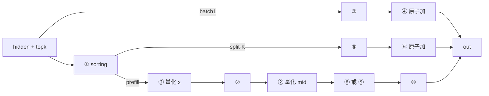

# MoE PTPC A8W4（Qwen3.8-Flash-Next，MI308X）：入口

<!-- mf:summary -->
> 由 mf 生成（11-21 21:25）· 目标：pyhip 新增 MoE 算子：bf16 激活按 token 量化成 fp8、权重 mxfp4；功能正确，decode 接近访存上限、prefill 接近算力上限（TP2/TP4 单卡形状）（1.094× 相对冻结基线）· 已完成 6 个里程碑（含本提交 M5） · 最佳累计 1.322× · 下一步：写报告
<!-- /mf:summary -->

> - **这是什么**：Qwen3.8-Flash-Next MoE（H=2560、E=512、top-10、SiLU，TP2 / TP4 单卡分片）在 MI308X 上的 A8W4 算子：mxfp4 权重 + 按 token 量化的 FP8 激活（decode 档保持 BF16 激活，见下一条）。入口是 [`prepare_weights`](weights.py#L130)（加载时把 checkpoint 的 mxfp4 转成 fd2 格式，只做一次）和 [`fused_moe`](moe.py#L85)，按配置表 [`CONFIGS`](moe.py#L36) 分档（各档路径与对照见 §2）。kernel 由 M0 移植到 `moe_gemm_2stage/` 的上游 aiter `gfx9_fp8` 派生，M0 只是底座。
> - **为什么这样设计**：decode（T≤128）用 W4A16（用户 11-21 选 A）：激活保持 BF16、mxfp4 在寄存器里精确展开，T=17–128 先排序走 split-K 的 BF16 MFMA；T≤16 每条路由只有一行激活，改用 VALU 上 f32 乘加的 gemv，因为持续的 BF16 MFMA 会让 MI308X 降频（M4）。prefill（T≥129）用 A8W4：gfx942 没有 FP4 MFMA，fp4 经 fd2 查表精确解成 FP8 进 FP8 MFMA（M2），M64 排序块的后 32 行全是补齐行时两级只算前 32 行、否则算满 64 行（M3）。两档 kernel 用的权重都与“mxfp4 反量化 + flush”逐位相同，输出对 FP32 参考满足 M0 的容差（§4）。
> - **现在最大的风险**：精度只在随机 mxfp4 权重上验证过：fd2 会把 scale 不到本通道最大组 scale 的 2^-11 的组整组置 0（flush），本机没有 Qwen3.8 的 mxfp4 checkpoint，真实权重上被置 0 的比例和由此带来的误差都没统计（§7 M1、M2 已知问题）。性能余量最小的是 split-K 档（T=17–128）：TP2 T=32 / 128 为 aiter_ptpc 的 1.028 / 1.018×（门限 1.053×），它仍发 BF16 MFMA，是否降频只看过 T=32（§7 M4 已知问题）。

## 1. 路线图
<!-- mf:roadmap -->
| 里程碑 | 状态 | 类型 | 标题 | 增量（预期） | 累计 | 用例 | 复核 | 提交 |
|---|---|---|---|---|---|---|---|---|
| M0 | ✅ 已推送 | 功能 | 把上游 aiter gfx9_fp8 的 kernel 更新到 pyhip moe_gemm_2stage（同名文件替换 / 更新） | — | — | ✓ | 冷读✓ 3分 | [moe-ptpc-a8w4-M0](https://github.com/luocheng25/pyhip/commit/e433e8d9184cdc5fd387641a00bc5686abec37cc) |
| M1 | ✅ 已推送 | 功能 | W4A16 decode：mxfp4 权重格式 + decode 路径（配置表 decode 档，当前 T≤128） | — | — | ✓ | ✓ | [moe-ptpc-a8w4-M1](https://github.com/luocheng25/pyhip/commit/cc271e29d151356c40607da4db96af8ea068e459) |
| M2 | ✅ 已推送 | 功能 | A8W4 prefill：fd2 解码接入 fp8 MFMA（配置表 prefill 档，当前 T≥129） | — | — | ✓ | ✓ | [moe-ptpc-a8w4-M2](https://github.com/luocheng25/pyhip/commit/2e5a428be2a332b3e45fe3879b4391f26fee0b8c) |
| M3 | ✅ 已推送 | 性能 | T=1024 prefill 追上 aiter_ptpc（TP2/TP4） | 1.238× 对基线（预期 1.1×） | 1.238× | ✓ | ✓ | [moe-ptpc-a8w4-M3](https://github.com/luocheng25/pyhip/commit/a294918e917414d1b8b72dfce070209fb3565920) |
| M4 | ✅ 已推送 | 性能 | TP2 T=16 decode 追上 aiter_ptpc（假设 H1：w1 每 lane 每轮读 16 B） | 1.074× 对 M3（预期 1.05×） | 1.322× | ✓ | ✓ | [moe-ptpc-a8w4-M4](https://github.com/luocheng25/pyhip/commit/5c562dc418d5cf405015786fdd938e43756a6e8c) |
| M5 | ✅ 本提交 | 维护 | 入口文档按最终结果更新（顶部摘要、各档路径一览、M4 标题更正） | — | — | ✓ | ✓ | 本提交 |

下一步（本提交的承诺）：写报告
<!-- /mf:roadmap -->

## 2. 性能

**各 T 档路径与对照**（最终状态，即 M4 提交；a8w4 是 mf 复核 V3 的同卡 ABBA 4 对、GPU0，aiter_ptpc 取同次 8 次运行的中位数，见任务目录 `notes/r1-final-percase.txt`；括号里是 a8w4 ÷ aiter_ptpc 的耗时比，<1 为 a8w4 更快）：

| T 档（配置表） | 算法 / tile | bench T | TP2 µs（÷ aiter_ptpc） | TP4 µs（÷ aiter_ptpc） |
|---|---|---|---|---|
| 1 | decode W4A16 · gemv（VALU f32 乘加）：Gate/Up gn32、Down dn64 | 1 | 22.4（0.340） | 19.2（0.342） |
| 2–16 | decode W4A16 · gemv：gn128 / dn64 | 8 | 66.1（0.819） | 45.4（0.748） |
| 〃 | 〃 | 16 | 117.5（0.876） | 76.7（0.769） |
| 17–128 | decode W4A16 · split-K（BM16 排序，BF16 MFMA）：gn128 / dn128 | 32 | 210.1（1.028） | 137.9（0.971） |
| 〃 | 〃 | 128 | 391.9（1.018） | 251.1（0.946） |
| ≥129 | prefill A8W4 · M64 排序，Gate/Up 1x4 gn128 BK128 → Down 1x4 M64×N256（FP8 MFMA）；后 32 行全补齐的块只算 32 行 | 1024 | 402.2（0.863） | 284.3（0.861） |
| 〃 | 〃 | 8192 | 1568.6（0.844） | 1085.6（0.749） |
| 〃 | 〃 | 65536 | 11686.6（0.878） | 7923.5（0.747） |

- 结论：16 个 case 全部 ≤1.053× aiter_ptpc（SPEC 的每 case ≥0.95×；最慢的是 TP2 T=32，1.028×），几何平均 0.766×。
- 后续：把 decode/prefill 交界下移可让 T=32..128 再快 9%–14%（TP2，L1 自测；TP4 最多约 7%，见 §7 M3 已知问题），但会改变冻结 bench 的计时口径、这些 T 也会从 W4A16 变成 A8W4，要重新冻结，等用户决定。

<!-- mf:perf -->
M4 的复核（V3：同卡 ABBA 4 对，GPU0，噪声 ±0.24%，冻结基线 `2e5a428be2`）

| case | 基线 | 当前 | 累计加速 | 增量加速 |
|---|---|---|---|---|
| tp2_t1 | 23.2405 | 22.3905 | 1.039× | 1.043× |
| tp2_t1024 | 552.923 | 402.162 | 1.373× | 0.994× |
| tp2_t128 | 392.032 | 391.921 | 1.000× | 1.001× |
| tp2_t16 | 140.641 | 117.491 | 1.197× | 1.244× |
| tp2_t32 | 210.291 | 210.091 | 1.000× | 1.000× |
| tp2_t65536 | 12828.4 | 11686.6 | 1.099× | 1.000× |
| tp2_t8 | 74.4005 | 66.11 | 1.125× | 1.127× |
| tp2_t8192 | 1800.94 | 1568.62 | 1.148× | 0.999× |
| tp4_t1 | 19.56 | 19.25 | 1.016× | 1.021× |
| tp4_t1024 | 399.612 | 284.321 | 1.405× | 1.002× |
| tp4_t128 | 251.341 | 251.121 | 1.001× | 1.000× |
| tp4_t16 | 86.8305 | 76.7105 | 1.132× | 1.133× |
| tp4_t32 | 137.951 | 137.921 | 1.000× | 0.999× |
| tp4_t65536 | 9176.55 | 7923.48 | 1.156× | 0.999× |
| tp4_t8 | 50.2305 | 45.38 | 1.108× | 1.109× |
| tp4_t8192 | 1300.26 | 1085.64 | 1.199× | 1.000× |
<!-- /mf:perf -->

- 验收口径（用户 11-21 确认）：每个 case 的 `latency_us` 基本达到同形状 aiter_ptpc（FP8 ptpc，A8W8）的水平，bench 里的 `aiter_ptpc` 是对照行；摘要里“decode 接近访存上限、prefill 接近算力上限”是任务方向的描述。基线已在 M2（`2e5a428be2`，bench 3 次取中位数）冻结：按 SPEC 换算，指标只计未达“每 case ≥0.95× aiter_ptpc（耗时 ≤1.053×）”的 3 个 case（TP2 T=16、TP2 / TP4 T=1024），目标是相对基线加权几何平均 1.094×（myflow 任务的 `plan.md`）；上面 mf 生成的块是复核结果（M4：累计一列相对冻结基线，增量一列相对 M3），M0–M2 无性能主张。下面几条都不是 mf 复核的数据，来源见 [深度参考 §5](m0_upstream_replacement.md#sources)。
- M0 替换前后（编排者复测，6 轮轮换，`runs/20261121-094917-_task-run-8e2d/out.log`）：中位比值（替换后 ÷ 替换前的耗时，6 轮的中位数，大于 1 为变慢）在默认 RTA 下 prefill（T≥1024）为 1.002–1.005，TP4 T=65536 为 0.963（改用上游 compact），decode（T≤128）为 0.988–1.023（最慢的是 TP2 T=32）；改用 RTE 则 prefill 慢 3.1–4.0%（TP4 T=65536 因同时换成 compact 为 1.003）。
- M0 的 FP8 路径（`fly_ptpc`，不是 a8w4）与 aiter_ptpc 参考行相比（实现者自测，f97327ce，`runs/20261121-101211-_task-run-bebe/out.log`）：T=1024 两个 TP 都慢（1.27×、1.24×），TP2 T=32 / 128 为 1.01× / 1.03×，其余 12 个 case 更快。
- M0 验收项“`bench_tuned_moe` 替换前后对比”（编排者，[深度参考 §5](m0_upstream_replacement.md#sources)）：43 个 case 初筛 9 个慢 3% 以上，两轮复测后只剩 mimo_ptpc M=256（约 +12%，原因是 tuner 在 jit_splitk 与 aiter 之间选择翻转，用户已接受为后续事项，见 §3.6 第 4 条）；qwen35_35B M=16 三次为 1.050 / 1.066 / 1.027，贴着 3% 门槛。
- M2 自测（实现者，`runs/20261121-163935-_task-run-61df/out.log`，`--mf --check`）：a8w4 ÷ aiter_ptpc 的 16 个 case 几何平均 0.867×（a8w4 更快，主要因为 T=1 时 aiter 慢：0.354 / 0.342），按 SPEC 每 case ≥0.95×（耗时 ≤1.053×）未达到的有 TP2 T=16（1.213×）、TP2 T=1024（1.216×）、TP4 T=1024（1.244×），是性能阶段的目标（M3、M4 已达到，见本节开头的表）；prefill 6 个 case 的 a8w4 ÷ fly_ptpc（M0 FP8）为 0.961–1.071（几何平均 1.015）。
- M3 自测（L1 实现者，A6 = `8c123ceefb`，`runs/20261121-191253-L1-run-3f52/out.log`，`--mf --check`，rc=0）：a8w4 tp2_t1024 400.1 µs、tp4_t1024 286.0 µs，同次 aiter_ptpc 465.1 / 329.3 µs（0.860 / 0.868）；16 个 case 都在容差内，a8w4 对 FP32 参考 logits_diff ≤ 9.9e-6。
- M4 自测（L2 实现者，A5 = `dfe23246`，基于 M2）：tp2_t16 146.1→117.2 µs（1.246×，冻结时 aiter_ptpc 134.2 µs）；同卡轮换 4 轮（`runs/20261121-185220-L2-run-1113/out.log`）A5 ÷ 基线 tp2_t16 为 0.770（0.729–0.814），A5 稳定在 117.6–117.8 µs、不再两态跳，其余 decode 0.88–0.97、tp4_t1 1.002；`--check` 对 FP32 参考 logits_diff ≤ 8.1e-6。叠加到 M3 上（A7 = `bc708dc3`）的正式数字见上表。
- 解读：prefill 排序用 `accumulate=False`，省掉 fly_ptpc 路径的两次 T×H 清零，与 FP8 对照时比值略偏向 a8w4；TP4 T=65536 的 fly_ptpc 用 compact Down，a8w4 只有 1x4。基线在 M2 之后冻结（bench 3 次取中位数）；最终数字以 mf 复核 V3 为准（本节开头的两张表）。

## 3. 设计

### 3.1 术语
- **上游**：ROCm/aiter@df3e0b2f 的 `aiter/ops/flydsl/kernels/moe_gemm_2stage/gfx9_fp8/`，在 pyhip 里是 `moe_gemm_2stage/` 的 9 个同名文件。
- **legacy**：替换前的 pyhip 实现，原样移到 `*_legacy.py`（`gemm2_default.py` 保留原名），只给上游不支持的配置用。
- **分流**：[`gemm_implementation`](../moe_gemm_2stage/gemm.py#L39) 对一个 `compile_gemm` 配置返回 `"upstream"` 或 `"legacy"`，在按设备的编译缓存里只判定一次。
- **ptpc / A8W8 / W8A16 / A8W4**：ptpc 是 FP8（E4M3FNUZ）量化，激活每 token 一个 fp32 scale、权重每输出通道一个。A8W8 = 激活和权重都是 FP8（M0 的 prefill）；W8A16 = FP8 权重在寄存器里展开成 BF16，与 BF16 激活做 BF16 MFMA（M0 的 decode）；A8W4 = 权重换成 mxfp4：M2 的 prefill 档激活为 FP8，M1 的 decode 档是 W4A16（mxfp4 权重展开成 BF16，与 BF16 激活做 BF16 MFMA；M4 起 T≤16 的 gemv 改在 VALU 上做 f32 乘加，权重与激活仍精确）。
- **路由 / 排序行 / 任务**：一个 (token, top-k 槽) 是一条路由；`moe_sorting` 把路由按专家排序并按 BM 补齐成排序行，每 BM 行是一个任务。
- **decode / prefill**：`tuned_moe` 的 `fly_decode`（读 BF16 激活，batch1 或 split-K）与 `fly_prefill`（两级 GEMM 的输入都按 token 量化成 FP8）；配置表里 decode 档当前是 T≤128、prefill 档是 T≥129。
- **batch1 / gemv / split-K / 1x4 / compact**：batch1 不排序，每条路由单独一组 CTA；gemv（M4，只在 a8w4 的 decode 档）网格与权重读取同 batch1，但乘加在 VALU 上做 f32 FMA、不发 MFMA；split-K 先排序，Gate/Up 的 4 个 wave 沿 K 切分（Down 的 split-K 每个 CTA 只有 1 个 wave、不切 K，只是沿用算法名）；1x4 是 prefill 的 M64×N256 Down；compact 是任务表驱动的 M256 full（8x1，8 wave）加 M64 tail（1x4）Down。
- **BM / BN / BK 与 gm·gn·gk·dm·dn**：tile 在排序行、输出通道、归约维上的尺寸；配置里 g = Gate/Up、d = Down，如 gn128 是 Gate/Up 的 BN=128。
- **RTA / RTE**：FP32→BF16 舍入。简化 RTA = `(bits + 0x8000) >> 16`（中点远离零，可能不保留部分 NaN）；RTE = 就近偶数并保留 NaN。
- **覆盖项 id**：A 接口契约、B 分流与变体、C 边界、D 执行模式、E 数值，如 B12；逐项含义见 §4 与 [深度参考 §3–4](m0_upstream_replacement.md#routes)。

其余术语（`METADATA_TILE_SIZE_M`、full / tail 容量、padding 128 B、shuffle、`jit_*`、mimo_ptpc、fd2 解码、logits_diff、中位比值）见 [深度参考 §0](m0_upstream_replacement.md#terms)。

### 3.2 模块与接口
文件对应（`moe_gemm_2stage/`；增删行数见 [深度参考 §1](m0_upstream_replacement.md#files)）：

| 上游同名文件（生产） | 对应 legacy | 相对上游的改动 |
|---|---|---|
| `__init__.py` | — | `compile_gemm` 改从 `gemm.py` 导入（按设备缓存 + 分流），并多导出 `compile_moe_reduction` |
| `common.py` | `common_legacy.py` | aiter 依赖换成本地 `get_gfx_runtime` / `get_cu_num` / `_run_compiled`，舍入默认改为 RTA（legacy 共用） |
| `gemm1.py` | `gemm1_legacy.py` | 内容不变，原名 `_build_moe_gemm1` 指向 legacy 版 |
| `gemm2.py` | `gemm2_legacy.py`、`gemm2_default.py` | 只改 compact builder 的名字 |
| `gemm2_1x4.py` | `gemm2_1x4_legacy.py` | 不变 |
| `gemm2_8x1.py` | `gemm2_8x1_legacy.py` | 上游 builder 改名 `_upstream`（只作 compact 的 full 任务），原名指向 legacy 的独立 8x1 |
| `gemm2_8x1_compact.py` | `gemm2_8x1_compact_legacy.py` | builder 与 `allocate_task_buffers` 加 `_upstream`，原名指向 legacy 版（上游没有 K=320） |
| `moe_reduce.py` | —（pyhip 函数在同一文件末尾） | 上游 `sorted_sum` 改名 `sorted_sum_upstream` 且不用，生产用 pyhip 按设备的 `sorted_sum` 与 `invert_sorted_ids` |
| `quant.py` | — | `_run_compiled` 改从 `common.py` 导入（pyhip 内无调用方） |
| — | `gemm.py`（pyhip 独有） | 分流，并把上游 batch1 / compact 的 launcher 包装成 pyhip 调用约定 |

| 符号 | 签名 | 约束 / 报错 | 说明 |
|---|---|---|---|
| [`tuned_moe.fused_moe`](../../tuned_moe.py#L629) | aiter `fused_moe` 的参数加 `output` | 输入约束与报错见表下 | Qwen3.8 用 `per_Token` 与 `Silu`，M0 未改 |
| `pyhip.testing.moe.make_moe_runner(config)` | 固定一个 `tuned_moe` 候选 | 用例先断言 config 是 `_configs()` 会生成的候选 | 用例与 bench 用它固定 `FLY_CONFIGS`（§3.3） |
| [`compile_gemm`](../moe_gemm_2stage/gemm.py#L322) | `(N, K, weight_dtype, weight_quant_type, TOPK, BLOCK_TILE_SIZE_M, BLOCK_TILE_SIZE_N, stage, alg, E, …, has_num_local_tokens=False)` | 上游 builder 的断言；legacy 保留 pyhip 原断言与中文报错 | 返回 pyhip 调用约定的 launcher；新增的 `has_num_local_tokens=True` 例外，见表下 |
| [`gemm_implementation`](../moe_gemm_2stage/gemm.py#L39) | 同 `compile_gemm` | 不报错 | 返回 `"upstream"` / `"legacy"`，规则见下 |
| `moe_gemm_2stage.compile_moe_gemm1/2` | 上游签名 | 上游断言 | 包导出改为上游 builder（替换前是 pyhip 的），pyhip 内无调用方 |
| `moe_gemm_2stage` 包的新增导出 | `compile_gemm`、`sorted_sum`、`flydsl_absmax`、`flydsl_quant_per_tensor` | — | 替换前只导出 `compile_moe_gemm1/2` 与 `compile_moe_reduction` |
| `quant.flydsl_absmax` / `flydsl_quant_per_tensor` | 上游 | — | absmax 不再自行清零 Amax，amax=0 时输出 0（pyhip 内无调用方） |
| 环境变量 `AITER_FLYDSL_MOE_BF16_RTA_SIMPLIFIED` | 默认 `1` | 在导入 `common.py` 时读取 | 1 为简化 RTA，0 为 RTE，上游与 legacy 共用 |
| 环境变量 `AITER_FLYDSL_MOE_BF16_RTE_SIMPLIFIED` | 默认 `0` | 只在上一行设为 0（RTE）时起作用 | 1 为简化 RTE（`(bits + 0x7FFF + ((bits >> 16) & 1)) >> 16`，不保证保留 NaN），0 为保留 NaN 的 RTE（inline asm） |
| 环境变量 `MOE_PREFILL_TILE_K` | Gate/Up 的 BK | `compile_gemm` 在分流前解析 | 只作用于 Gate/Up，上游 Down 不读 |
| 环境变量 `CU_NUM` | 覆盖 CU 数 | 只改上游 `get_cu_num()` | 上游 Down 按 CU 数是否为 80 判定 MI308X |
| [`a8w4_ptpc.prepare_weights`](weights.py#L130)（M1、M2） | `(w1, w1_scale, w2, w2_scale, *, chunk=32)` → `MXFP4Weights` | dtype 不对报 `TypeError`；维数 / 形状不一致、`H % 256 ≠ 0`、`I % 32 ≠ 0` 或 I=0、E8M0 code 255 报 `ValueError` | 加载时调用一次；输入布局见本节末尾，输出格式见 [weights.py 模块说明](weights.py#L1)；I 补零到 64 的倍数（TP4 160→192）；M2 起另算 prefill 的 delta 排列 |
| [`a8w4_ptpc.MXFP4Weights`](weights.py#L48)（M1、M2） | frozen dataclass：`w1`、`w1_delta`、`w1_factor`、`w2`、`w2_delta`、`w2_factor`、`inter`、`inter_padded`；M2 加 `w1_pdelta` uint8 `[E, 2I/16, H/256, 2, 16, 4]`、`w2_pdelta` uint8 `[E, H/64, I/32, 16, 4]`；属性 `experts`、`hidden` | 只由 `prepare_weights` 构造 | decode（M1）用 `*_delta`，prefill（M2）用 `*_pdelta`：同一批 delta 字节按 prefill kernel 的读法另存（[weights.py L17](weights.py#L17)），其余字段共用 |
| [`a8w4_ptpc.fused_moe`](moe.py#L85)（M1、M2） | `(hidden_states, weights, topk_weight, topk_ids, *, output=None, config=None)` → `output` | 见本节末尾；`config` 的 path 不是 decode / prefill 时在启动前报 `ValueError`（M2） | `Σ_k topk_weight · Down(SiLU(Gate x) · Up x)`，只有 SiLU；decode、prefill（M2 起可用）两档；不调优、不回退 aiter |
| [`a8w4_ptpc.select_config`](moe.py#L46) / [`decode_max_tokens`](moe.py#L54) / [`CONFIGS`](moe.py#L36)（M1–M4） | `select_config(tokens, configs=CONFIGS)` → 配置副本；`decode_max_tokens(configs=CONFIGS)` → decode 档上界（当前 128） | 不报错；T 超过所有上界时取最后一行 | 档位只看 `CONFIGS`，代码里不写交界；decode 行 M4 起为 T=1 `alg="gemv"` gn32 / dn64、2–16 gemv gn128 / dn64（M1–M3 是 batch1 gn32 / gn64）、17–128 split-K；prefill 行（M2）为 `tile_m=64, tile_n_gate=128, tile_k_gate=128, tile_n_down=256, padding=128`，M3 加 `half_m=True, prefetch_gate=2, prefetch_down=2, quant="fly"`；`config=` 缺这 4 个键时按 M2（`False`、1、1、aiter 量化），`quant` 不是 `"fly"` 的值都走 aiter、不报错 |
| [`a8w4_ptpc.prefill.compile_prefill_gemm`](prefill.py#L1266)（M2、M3） | `(*, stage, N, K, TOPK, BLOCK_TILE_SIZE_M, BLOCK_TILE_SIZE_N, tile_k=None, padding=0, E=None, half_m=False, prefetch=1)` → launcher | Gate/Up：`tile_k` ∈ {128, 256}、`K % 256 == 0`、K/BK 为偶数、BN ∈ {128, 256} 且 `N % BN == 0`、BM 为 32–256 中 32 的倍数；Down：只有 BM×BN = 64×256（`fused_moe` 两级共用 `tile_m`，所以只能取 64）、`N % 256 == 0`、`K % 64 == 0`、64·K + 9 KiB ≤ 64 KiB（K ≤ 880）；M3：Gate/Up 的 `prefetch` ∈ {1, 2}、`half_m` 要 BM % 64 == 0，Down 的 `prefetch` ≥ 1；不满足报 `AssertionError` | 按设备缓存；两级参数都是 `(输入 FP8, 权重, 输出, sorted_ids, sorted_weights, sorted_expert_ids, num_valid_ids, 通道因子, pdelta, a_scale, M, 任务数, stream)`。M3：`half_m` 时排序块第 BM/2+1 行是补齐行就只算（Down 只写）前 BM/2 行；`prefetch` 是权重提前读的步数，Gate/Up 只用于 ≤32 行的 tile（64 行 tile 固定 1），Down 实际取 min(prefetch, K/64) |
| [`a8w4_ptpc.prefill.compile_prefill_quant`](prefill.py#L1295)（M3） | `(cols)` → `(launch, rows_per_block)`；`launch(x, q, scale, rows, blocks, stream)` | `cols % 8 == 0`，否则 `AssertionError` | 按设备缓存；BF16 `[rows, cols]` 按行量化成 FP8 `q` 与 fp32 `scale[rows]`，算术同 `pyhip.testing.moe_a8w4_ptpc.quantize_rows`（逐位相同）；每行 min(64, cols/8 的最大 2 的幂因子) 个 lane，每 CTA 256 线程；`blocks` 由调用方取 ⌈rows / rows_per_block⌉，越过 `rows` 的行不写；生产经 [`moe._quantize_rows`](moe.py#L130) 调用 |

`fused_moe` 走本地 kernel 的输入（[`_native_kind`](../../tuned_moe.py#L40) 检查；任一条不满足就整体转交 aiter，不报错）：
- `hidden_states`：BF16 `[T, H]`，0 < T < 2^24，`H % 128 == 0`；所有张量在同一 CUDA 设备上且连续，架构为 gfx942 或 gfx950。
- `w1`：FP8 E4M3FNUZ（gfx950 上是 E4M3FN）`[E, 2I, H]`，前 I 行是 gate、后 I 行是 up；`w2`：同 dtype `[E, H, I]`；`I % 64 == 0`。两者都要经 aiter `shuffle_weight` 重排并带 `is_shuffled = True`，属性丢失时按原始布局处理，只剩 aiter 候选。
- `w1_scale` / `w2_scale`：fp32，元素数分别为 E·2I 和 E·H（用例传 `[E, rows, 1]`）。
- `topk_ids`：int32 `[T, topk]`（0 < topk < 256），`topk_weight`：fp32、同 shape；调用方保证 0 ≤ `topk_ids` < E，本地路径不检查。
- 其它参数（完整条件以 [`_native_kind`](../../tuned_moe.py#L40) L40–145 为准）：`quant_type=per_Token`；`activation` 为 Silu / Swiglu / SiTUv2，Silu 不能带 `swiglu_limit`，Swiglu 的 `swiglu_limit` 不能为 0；`gate_mode` 为 separated；`dtype` 为 None 或 BF16；张量都不 `requires_grad`；权重没有 aiter 的 padding 属性（`inter_real`、`aiter_original_k`、`aiter_padded_k`）；`expert_mask`、`num_local_tokens`、`a1_scale`、`a2_scale`、`bias1`、`bias2`、`shared_w1`、`shared_w2`、`shared_w1_scale`、`shared_w2_scale`、`stage2_scatter`、`quant_type_a`、`quant_dtype_a`、`quant_dtype_a2` 都为 None；`doweight_stage1`、`hidden_pad`、`intermediate_pad`、`splitk` 为 0 / False，`shared_expert_id=-1`，`moe_sorting_dispatch_policy=0`。
- 输出与报错：写入并返回 `output`（不传就新建），BF16 `[T, H]`；传入的 `output` 与 `hidden_states` 的 shape、dtype、device 不同或不连续时报 `RuntimeError`（[L692](../../tuned_moe.py#L692)），与任一输入内存重叠时也报 `RuntimeError`（[L698](../../tuned_moe.py#L698)）；调优时 torch 参考含 NaN / Inf（[L541](../../tuned_moe.py#L541)）、没有候选通过参考检查（L563），或在 CUDA graph capture 中触发调优（L536），同样报 `RuntimeError`。

`compile_gemm(has_num_local_tokens=True)`（M0 新增，只上游支持，pyhip 内只有用例调用）：只允许 `alg="batch1"`（[gemm1.py L59](../moe_gemm_2stage/gemm1.py#L59)、[gemm2.py L56](../moe_gemm_2stage/gemm2.py#L56) 的断言）；不做包装，原样返回上游原生 batch1 launcher（[gemm.py L315](../moe_gemm_2stage/gemm.py#L315)）：参数多一个 token 数指针 `p_num_local_tokens`，并接收路由数 T·TOPK 而不是 T；计数之后的行不计算。

dispatch（[`gemm_implementation`](../moe_gemm_2stage/gemm.py#L39) 按顺序判定，首个命中即返回；括号里是覆盖项 id，例子见 [深度参考 §3](m0_upstream_replacement.md#routes)）：
1. `has_num_local_tokens=True` → 上游（B1）；`force_batch1_path` 先把 alg 改成 batch1（B2）。
2. 非 gfx942（B3）、权重不是 bf16 / fp8（B4）、激活不是 silu / swiglu（B5）、`METADATA_TILE_SIZE_M` 不是 None 或 BM（B6）、alg 不认识（B7）→ legacy。
3. Gate/Up：带 Down 参数 → legacy（B8）；prefill_1x4 要 `N % BN == 0`、`K % (2·BK) == 0`，BF16 另要 BK ∈ {64, 128} 且 A 的 LDS ≤ 64 KiB（B9–B13）；split-K、batch1 → 上游（B14）。
4. stage 不认识 → legacy（B15）。default Down：带 padding → legacy（B16）；prefill 要 `K % 64 == 0`、`N % 256 == 0`，BF16 另查 LDS（B17、B18）；其余 → 上游（B19）。
5. 1x4 / compact Down：要 prefill、FP8、BM64（B20），padding ∈ {0, 32, 64, 128}（B21），`K % 64`、`N % 256` 为 0（B22），LDS ≤ 64 KiB（B23）；1x4 还要 BN256（B24）；compact 还要 K ∈ {192, 256, 384, 512, 640}（B25）、N ≥ 512（B26）、BN128（B27）、0 < E ≤ 2048（B28）；独立 8x1 与未知 path → legacy（B29）。

例：Qwen3.8 的全部生产配置 → 上游（B30）；Qwen3.8 TP2 若选 compact（K=320）→ legacy；SiTUv2、FP4 / MXFP4、gfx950 → legacy；`tuned_moe` 的 `8x1`（BM256）候选 → legacy。

`a8w4_ptpc` 入口（M1–M4；输入检查在 [`_check`](moe.py#L67)，任何 kernel 启动之前完成，不满足就报错，不转交 aiter）：
- `prepare_weights` 的输入是单卡分片后的 checkpoint 自然布局：w1 uint8 `[E, 2I, H/2]`（一字节两个 E2M1，低半字节是偶数 k；前 I 行 gate、后 I 行 up），w1_scale uint8 E8M0 `[E, 2I, H/32]`；w2 `[E, H, I/2]`，w2_scale `[E, H, I/32]`；也接受 `torch.float4_e2m1fn_x2` / `torch.float8_e8m0fnu`（按字节读）。
- `fused_moe`：`weights` 不是 `MXFP4Weights` → `TypeError`；`hidden_states` 不是 BF16 `[T, H]` CUDA 张量、H 或设备与权重不符、`topk_ids` / `topk_weight` 不是 int32 / fp32 `[T, topk]`、任一张量不连续或不在同一设备、`output` 不是与 `hidden_states` 同形状的 BF16 → `ValueError`；`0 ≤ topk_ids < E` 由调用方保证，不检查。
- dispatch（[`select_config`](moe.py#L46) 查 [`CONFIGS`](moe.py#L36)）：T=0 直接返回；T=1 gemv gn32 / dn64；2–16 gemv gn128 / dn64（M4 起；gemv 与 batch1 一样每条路由一组 CTA、不排序，Gate/Up 顺带清零 `out`）；17–128 split-K gn128 / dn128（先调 aiter `moe_sorting`，并清零 `out`）；≥129（prefill 档，M2，[`_fused_moe_prefill`](moe.py#L142)）：aiter `moe_sorting`（M64，`accumulate=False`，不清零 `out`）→ 按 token 量化 `x`（M3 起是 FlyDSL kernel，`quant="aiter"` 时为 aiter）→ Gate/Up 1x4（gn128、BK128）写 BF16 `mid` → `mid` 按 (token, k) 量化 → Down 1x4（M64×N256，每个排序行写一行，行距补 128 B；M3 起两级对后 32 行全是补齐的排序块只算前 32 行，补齐行 `sorted_sum` 不读）→ `invert_sorted_ids` + `sorted_sum` 写全部 `out`。`config=` 可指定表外 tile：gemv 与 batch1 的 Gate/Up BN ∈ {32, 64, 128}、split-K ∈ {64, 128}，Down ∈ {64, 128}（decode 的 `alg` ∈ {`"gemv"`, `"batch1"`, `"splitk"`}，batch1 在 M4 后只经 `config=` 可达）；prefill 的 Gate/Up BN ∈ {128, 256}、BK ∈ {128, 256}，Down 只有 1x4（M64×N256）；其它值由 builder 的 `assert` 拒绝。
- prefill 档的形状限制（M2；编译期 `AssertionError`，`_check` 不查）：`H % 512 == 0`（最后的 `sorted_sum` 每线程 8 个 BF16、64 线程；Gate/Up 自身只要 `H % 256`）；补零后 I ≤ 880（Down 把 64 行中间激活放进 LDS；I 补到 64 的倍数，所以 I ≤ 832）。Qwen3.8（H=2560，I=320 / 160→192）都满足。I 超限在启动 Gate/Up 之前报错；H 不满足要到 Gate/Up、Down 已启动后构建 `sorted_sum` 时才报，`out` 不写（§3.6 第 11 条）。
- 编译：[`compile_decode_gemm`](decode.py#L1459)（M4 起 `alg` 可为 `"gemv"`，launcher 参数同 batch1）、[`compile_prefill_gemm`](prefill.py#L1266)（M2）与 [`compile_prefill_quant`](prefill.py#L1295)（M3）按设备缓存，同一设备同一配置只构建一次；decode 档与 prefill 档都可进 CUDA graph（用例在 capture 之前先调用一次完成编译）。

### 3.3 调用链
- 生产：`fused_moe` 能走本地 kernel 时，按 `batch_bucket = ceil_pow2(T)` 和 `model_key`（形状、dtype、布局、设备、环境变量）自动调优（[L576–579](../../tuned_moe.py#L576)）；候选（[`_configs`](../../tuned_moe.py#L148)）有 aiter、ASM `jit_*`、FlyDSL `fly_decode`（batch1 只在桶 ≤ 32）和 `fly_prefill`（桶 ≥ 64），在 torch 参考上 `calc_diff` ≤ 0.02 的候选里取最快的并缓存，胜出的不一定是 FlyDSL。
- 用例与 bench：[`FLY_CONFIGS`](../../../../testing/moe_a8w4_ptpc.py#L41) 经 `make_moe_runner` 强制走 FlyDSL，两级都判给上游（B30）：T=1 batch1 gn32；2–16 batch1 gn64；17–128 split-K；129–1024 prefill 1x4（TP2 gk128、TP4 gk256）；1025–8192 1x4 gk256；>8192 TP2 1x4 gk256、TP4 compact gk256（全表见 [深度参考 §0](m0_upstream_replacement.md#configs)）。交界当前是 128/129，M1、M2 跟随配置表：decode 档用 W4A16、prefill 档用 A8W4，调优后可能移动（用户 11-21 确认）。

| # | kernel | grid×block，LDS | 作用 |
|---|---|---|---|
| ① | `moe_sorting`（aiter） | aiter 自定 | 排序路由、按 BM 补齐，并清零 `out`（batch1 不用） |
| ② | 按 token 量化（aiter `get_hip_quant`） | aiter 自定 | prefill 时把 `x`、`mid` 各量化成 FP8 |
| ③ | [`moe_2stage_gateup_batch1`](../moe_gemm_2stage/gemm1.py#L746) | (N/BN, 10, T)×256，16 KiB | 一条路由 × BN 列，4 个 wave 沿 K 切分，顺带清零 `out` |
| ④ | [`moe_2stage_down_batch1`](../moe_gemm_2stage/gemm2.py#L293) | (2560/64, 10, T)×64，无 | 一条路由 × 64 列，BF16 原子加到 `out` |
| ⑤ | [`moe_2stage_gateup_splitk`](../moe_gemm_2stage/gemm1.py#L633) | (N/128, 任务数)×256，16 KiB | 16 排序行 × 128 列，4 个 wave 沿 K 切分 |
| ⑥ | [`moe_2stage_down_splitk`](../moe_gemm_2stage/gemm2.py#L156) | (2560/128, 任务数)×64，1 KiB | 16 排序行 × 128 列，原子加到 `out` |
| ⑦ | [`moe_2stage_gateup_prefill_1x4`](../moe_gemm_2stage/gemm1.py#L856) | (N/128, 任务数)×256，16 / 32 KiB（gk128 / gk256） | 主 kernel：64 排序行 × 64 对 gate/up 通道，写 BF16 `mid` |
| ⑧ | [`moe_2stage_down_prefill_1x4_64x256`](../moe_gemm_2stage/gemm2_1x4.py#L227) | (1, 任务数)×256，TP2 29 KiB / TP4 21 KiB | 64 排序行 × 全部 2560 列，写按排序行排列的中间结果 |
| ⑨ | compact：[任务表](../moe_gemm_2stage/gemm2_8x1_compact.py#L55) → [8x1 full](../moe_gemm_2stage/gemm2_8x1.py#L719) → 1x4 tail | (1)×256，8 KiB → (1, full 容量)×512，64 KiB → (1, tail 容量)×256，21 KiB | TP4 T>8192 时代替 ⑧ |
| ⑩ | [`invert_sorted_ids`](../moe_gemm_2stage/moe_reduce.py#L215) → `sorted_sum`（pyhip） | (⌈排序行/64⌉)×64 → (T)×64，无 | 把每个 token 的 10 条路由求和写 `out` |

③–⑥ 在寄存器里把 FP8 权重展开成 BF16，再与 BF16 激活做 BF16 MFMA 16×16×16，即 W8A16（[common.py L949](../moe_gemm_2stage/common.py#L949)）；⑦⑧ 和 ⑨ 的 full / tail kernel 做 FP8 MFMA 16×16×32。N = 2·I（TP2 640、TP4 384；TP4 的 I=160 在加载权重时补零到 192，因为 Down 要 I % 64 == 0，C3）；任务数默认是排序后 BM 块的上限（越界的块直接返回），⑤⑥⑦ 在 M·TOPK ≤ E 时改为 M·TOPK（Qwen3.8 只在 T ≤ 51 时）。



### 3.4 tile 划分
主 kernel ⑦ Gate/Up prefill_1x4（Qwen3.8 配置 gm64 gn128，gk128 或 256；K = H = 2560）：

| 层级 | 形状 | 负责的数据 |
|---|---|---|
| CTA（256 线程 = 4 wave） | 64 排序行 × 128 列 × 全部 K | 一个任务的一组 64 个中间通道，输出 `mid` 的 64 行 × 64 通道 |
| wave | 16 个 gate 加 16 个 up 通道 × 64 行 | MFMA 的 M 维是权重通道（4 个 wave 沿通道并排），N 维是排序行 |
| lane | MFMA 16×16×32 FP8，每个 16×16 块 4 个 fp32 | gate、up 各 4 块（64 行 ÷ 16），各 16 个 fp32 累加器 |
| K 步 | BK = 128 或 256，共 K/BK = 20 或 10 步（必须为偶数） | A（激活）经 LDS ping / pong，B（权重）从 global 直接进寄存器双槽 |

`blockIdx.y` 选任务（同一专家的 64 个排序行），`blockIdx.x` 选通道组：gate 的 64 列加对应 up 的 64 列；A 按排序行 gather。

⑧ Down 1x4：CTA 是 64 排序行 × 256 列一块，沿 N 循环 2560/256 = 10 块，K（TP2 320、TP4 192）一次全部 gather 进 LDS；wave 负责 64 列 × 64 行；lane 持有 16 个 16×16 块 × 4 = 64 个 fp32；BK 在 K % 128 == 0 时为 128，否则 64（TP2 5 步、TP4 3 步）。

### 3.5 流水线伪代码
⑦ 的代码：[kernel](../moe_gemm_2stage/gemm1.py#L856)、[`gemm_1x4`](../moe_gemm_2stage/gemm1.py#L310)、[`pipeline_stage`](../moe_gemm_2stage/gemm1.py#L481)、[`hot_loop_scheduler`](../moe_gemm_2stage/gemm1.py#L454)、[主循环](../moe_gemm_2stage/gemm1.py#L529)、[SiLU 与舍入](../moe_gemm_2stage/gemm1.py#L241)、[CShuffle 写回](../moe_gemm_2stage/gemm1.py#L1011)。
```text
if blockIdx.y * BM >= num_valid: return                       # L883 越界任务直接返回
sorted_lds[0:BM] ← 本任务的 sorted_ids; barrier                 # L908
gemm_1x4():                                                    # L310
  A 的行索引 ← sorted_lds; barrier（之后 a_ping 复用这块 LDS）     # L355–L367
  # prologue
  A[k0]：按排序行 gather，global→寄存器；B_gate / B_up[k0]：global→寄存器槽 0   # L520
  s_waitcnt(vmcnt=0); A 寄存器→LDS ping; barrier                 # L523–L525
  # 主循环：每轮两拍，先读 ping 写 pong，再反过来
  for iv in range(K/BK/2 - 1):                                 # L529
      stage(read=0, next=2·iv+1); stage(read=1, next=2·iv+2)
  stage(read=0, next=最后一步); stage(read=1, 不预取)              # L538–L540
stage(read, next):                                             # L481
  发起 A[next]、B_gate / B_up[next] 的 global 读（VMEM，与本拍 MFMA 重叠；B 进槽 1-read）
  for ki in range(BK/64):
      A[read] LDS→寄存器; gate、up 各 2 次 K32 MFMA × 4 个行块
  A[next] 寄存器→LDS[1-read]                                    # L515
  hot_loop_scheduler：交错 ds_read / VMEM / MFMA / ds_write      # L454
  sched_barrier; barrier（下一拍才读刚写进 LDS 的 A）               # L517–L518
# epilogue
反量化：× w_scale[通道] × a_scale[token]                         # L971
SiLU(gate)·up → BF16（_f32_to_bf16，默认 RTA）                   # L984 → L275
barrier; BF16 写进 LDS（复用 a_ping）做 CShuffle; barrier; 128b 读回   # L1011–L1020
按排序行写 mid[token, top-k 槽, 通道]                             # L1021
```
主循环里没有显式 `s_waitcnt`：A[next] 写 LDS 之前、下一拍用 B 之前的 vmcnt 等待由编译器按数据依赖插入；写 LDS 与 `hot_loop_scheduler` 只在有预取的拍执行。

⑧ 的代码：[kernel](../moe_gemm_2stage/gemm2_1x4.py#L227)、[gather](../moe_gemm_2stage/gemm2_1x4.py#L34)、[K 步](../moe_gemm_2stage/gemm2_1x4.py#L554)、[N 循环](../moe_gemm_2stage/gemm2_1x4.py#L596)。
```text
e = _map_down_task()：任务号在 XCD 间交错；越界返回                  # L241
A[64 行, 全部 K] ← 按排序行 gather FP8 中间激活进 LDS; barrier       # L326（L34）
行系数 = 路由权重 × 激活的 token scale
prologue：B[n0, k0] global→寄存器槽 0；ptpc 时 w_scale[n0] 进 LDS    # L531
for n in range(2560/256):          # scf.for，循环携带下一块的 B 与 scale   # L596
    fragC = 0
    for k in range(K/BK):          # TP2 5 步、TP4 3 步（BK=64）        # L608
        A[k] LDS→寄存器；预取下一个 (n, k) 的 B 到另一槽（换 n 时也取 w_scale）
        MFMA fragC += B·A（优先级 3）                                   # L578
    fragC × w_scale[通道] × 行系数 → BF16                               # L613–L618
    每个 wave 经 16×64 BF16 的 LDS 做 CShuffle，写这 64 行的 256 列     # L619
```
BK=128 且只有 2 个 K 步时，上一块的写回会与下一块的 K 步重叠（[L529](../moe_gemm_2stage/gemm2_1x4.py#L529)）；Qwen3.8 的 K 不走这条。

### 3.6 已知限制
1. 两套实现并存：包内 `*.py` 由 8006 行增到 14158 行；只有上游不支持的配置走 legacy，修 bug 可能要改两处。
2. 测内部细节的旧用例（8x1 闭包变量、compact 签名、legacy 报错文本）测的是 legacy；上游 kernel 除 U、Q 外，也由 TM 的 `test_fly_decode`、`test_fly_direct`、`test_fly_swiglu`、`test_fly_down_paths` 和 TT 的 `test_fly_direct_clear_graph` 覆盖（gfx942 上 bf16 / ptpc / per_tensor × SiLU / SwiGLU 判给上游）。
3. gfx950、FP4 / MXFP4、SiTUv2 全走 legacy、代码未改：SiTUv2 的 bf16 / ptpc 用例在 gfx942 上会跑（B31）；FP4 / MXFP4 与 gfx950 的用例本机跳过（B32），无法实测。
4. `tuned_moe` 调优不稳：mimo_ptpc（见 [深度参考 §0](m0_upstream_replacement.md#terms)）M=256 经 `tuned_moe` 端到端慢 12%（初筛 1.136、复测 1.119），胜出配置从 ASM `jit_splitk` 换成 aiter；两边用同一调优配置时为 1.007。用户 11-21 决定接受：非替换造成，M0 不处理，记为 tuned_moe 调优不稳（调优测量与正式计时不一致）的后续事项。出处（编排者）：`runs/20261121-104005-_task-run-7733/out.log`（筛查）、`runs/20261121-104604-_task-run-af22/out.log`（复测）、`runs/20261121-105710-_task-run-57d8/out.log`（同一调优配置）。
5. 正确性命令排除 9 个替换前就失败的用例：`test_asm_batch_loopn` 8 个（ASM JIT 缓存文件名含 worktree 长路径，Errno 36）和 `test_aiter_signature` 1 个（/opt/aiter 的 `fused_moe` 多 3 个参数）。
6. 运行时仍依赖 aiter：`tuned_moe` 的排序、激活量化和 `_run_compiled`；kernel 文件本身不导入 aiter（A10）。`a8w4_ptpc` 的 split-K 与 prefill 调 aiter `moe_sorting`（T≤16 的 gemv 不排序）；prefill 的按 token 量化 M3 起默认是 FlyDSL kernel，只有配置 `quant="aiter"` 时才调 aiter（M2 的做法）。
7. `tuned_moe` 的 FP8 路径：TP4 补零在权重加载侧（`make_weights`）做，算子本身不补；未补零的 I=160 在 `tuned_moe` 里没有本地候选，只走 aiter。`a8w4_ptpc` 不受影响：`prepare_weights` 自己把 I 补零到 64 的倍数（M1）。
8. BF16 舍入默认 RTA，偏离上游的 RTE：中点差 1 个 BF16 ulp，简化 RTA 可能不保留部分 NaN；开关在导入 `common.py` 时读取，进程内再改环境变量不生效。
9. 替换带来的行为差异：`MOE_PREFILL_TILE_K` 不再作用于上游 Down；`CU_NUM` 会改变上游 Down 对 MI308X 拓扑的判断；`has_num_local_tokens` 只有用例在用。
10. 文档：`moe_gemm_2stage/README.md` 的性能与资源数字是替换前 legacy 实现的测量；`tests/ops/moe/README.md` 的 a8w4_ptpc 段在 M0 时已过时（没有 T=65536、没提新用例），M1–M4 已逐次更新到当前用例。
11. `a8w4_ptpc` 的 prefill 档（M2）：Down 只有 1x4，TP4 T>8192 没有 compact（推迟到性能阶段，M3、M4 都没做，留作后续）；形状要求 `H % 512 == 0`、补零后 I ≤ 880（即 I ≤ 832），不满足时报 `AssertionError`（编译期断言，`_check` 不查），其中 H 不满足要到 Gate/Up、Down 已启动之后构建 `sorted_sum` 时才报，`out` 不写（复核实测 H=256，`runs/20261121-170845-_task-run-0d5c/out.log`）。

## 4. 测试
用例前缀：`U` = [a8w4_ptpc/test_moe_gemm_2stage_upstream.py](../../../../../../tests/ops/moe/a8w4_ptpc/test_moe_gemm_2stage_upstream.py)（94 个，只构建 launcher 或编译小 kernel），`Q` = [a8w4_ptpc/test_qwen38_ptpc.py](../../../../../../tests/ops/moe/a8w4_ptpc/test_qwen38_ptpc.py)（34 个，Qwen3.8 端到端），`TM` = `tests/ops/moe/test_moe.py`，`TT` = `tests/ops/moe/test_tuned_moe.py`（TM、TT 本里程碑未改）。`U::routes[x]` = `test_compile_gemm_routes[x]`，`U::adapt[x]` = `test_compile_gemm_adapts_launchers[x]`。覆盖项共 63 个，逐项见 [深度参考 §4](m0_upstream_replacement.md#coverage)。

| 类别 | 用例 | 覆盖项 | 说明 |
|---|---|---|---|
| 分流 | U::routes（68 个） | B1–B29、C4 | 每条规则至少一例（多数规则两侧各一例），断言判定结果、实际调用的 builder，以及上游 builder 能否构建 |
| 适配 | U::adapt（12 个） | A1、A2、A4、A5 | batch1 / compact 包装的闭包、签名、compile_hints 与 `cu_count`；其余出口原样返回 |
| 缓存与环境 | U::test_compile_gemm_routes_once_per_device、test_compile_gemm_prefill_tile_k_env、test_chip_info_stand_ins | D1、A13、A11 | 每设备只判定一次；TILE_K 只作用于 Gate/Up；`CU_NUM` 与非 gfx942 报错 |
| 符号与依赖 | U::test_pyhip_symbols_keep_their_modules、test_kernel_modules_import_without_aiter、test_run_compiled_compiles_once_and_recovers | A7–A10、D4 | 原名符号还在原模块；屏蔽 aiter 后能导入；编译失败后可恢复 |
| compact 容量 | U::test_compact_task_buffers_match_upstream_split | A3、C5 | pyhip 分配的任务缓冲与上游按同一 CU 数的拆分容量相等 |
| 舍入与量化 | U::test_bf16_rounding_switch（4 个）、test_f32_to_bf16_follows_switch（2 个）、test_flydsl_quant_per_tensor_contract | E2、E3、A12、E6、C6 | 开关默认 RTA、0 为 RTE；逐位位型；absmax 不清零、amax=0 输出 0 |
| 端到端 | Q::test_matches_reference（25 个） | B30、C1–C3、E1 | TP2 / TP4 × T ∈ {1, 8, 16, 32, 128, 129, 256, 257, 1024, 2000, 8192, 65536}，TP4 另加 8200；对 FP32 参考，并断言两级都判给上游、alg 与 Down path 就是配置表这一档 |
| graph 与 RTE | Q::test_decode_cuda_graph（4 个）、test_rte_rounding_matches_reference（4 个）、test_num_local_tokens_skips_padding_rows | D2、E4、A6、D3 | decode 三种配置 replay 新输入；RTE 下同一参考与容差；计数之后的行不写 |
| 现有用例·上游 | TM::test_fly_decode、test_fly_direct、test_fly_swiglu、test_fly_down_paths（default / 1x4 / compact），TT::test_fly_direct_clear_graph 等 | A1、A7、D5、D6、E5 | gfx942 上 bf16 / ptpc / per_tensor × SiLU / SwiGLU 判给上游，用小形状对 torch 参考（`calc_diff` ≤ 0.02）；两卡用例本机跳过 |
| 现有用例·legacy | TM::test_fly_situv2_*、test_fly_down_paths（8x1、compact K=320）、test_fly_down_8x1_* 等，TT 的报错文本用例 | B31、B32 | SiTUv2、独立 8x1、compact K=320、METADATA≠BM、legacy 报错文本；FP4 / gfx950 用例本机跳过 |
| 性能 | [bench_moe_a8w4_ptpc.py](../../../../../../benchmarks/moe/bench_moe_a8w4_ptpc.py) `--mf` | — | TP2 / TP4 × T ∈ {1, 8, 16, 32, 128, 1024, 8192, 65536} 共 16 个 case，覆盖 batch1、split-K、1x4 gk128 / 256、compact；`aiter_ptpc` 为参考行 |

- Q 的容差沿用上游 aiter `op_tests/test_flydsl_moe_gfx942.py`：逐元素偏差不超过该 token 参考值 RMS 的 1 倍、`logits_diff` < 1e-3（`1 − 2·Σxy / Σ(x² + y²)`，与 `calc_diff` 同一公式）、最差 token 的相对 L2 误差 < 0.2（[`check_output`](../../../../testing/moe_a8w4_ptpc.py#L253)）。
- 最先失败的用例：正确性命令按 test_moe → test_tuned_moe → a8w4_ptpc 的顺序跑（带 `-x`）。改坏上游 kernel 的数值时，最先失败的是 TM 里走上游的 `test_fly_decode`（split-K）、`test_fly_direct`（batch1）、`test_fly_swiglu`、`test_fly_down_paths`；只跑 a8w4_ptpc，或误差小到 `calc_diff` ≤ 0.02 抓不到时，才由 Q::test_matches_reference 先发现。改坏分流或适配层时，U::routes / U::adapt 直接定位到出错的规则（U 文件不跑 kernel 主体，测试负责人实测约 8 s）。测试负责人在源码临时副本上做了 22 处变异，全部被新用例检出。
- M0：task.json 的正确性命令在最终状态为 1344 通过 / 733 跳过 / 191 deselected（测试负责人，`runs/20261121-132445-_task-run-0738`）。

**M1（W4A16 decode）覆盖**：前缀 `D` = [a8w4_ptpc/test_a8w4_decode.py](../../../../../../tests/ops/moe/a8w4_ptpc/test_a8w4_decode.py)（M1 提交时 18 个，M2 删去 1 个后 17 个，实现者），`DE` = [a8w4_ptpc/test_a8w4_decode_edges.py](../../../../../../tests/ops/moe/a8w4_ptpc/test_a8w4_decode_edges.py)（12 个，复核补充）。GPU 用例的参考是 mxfp4 精确反量化（施加同一 flush 规则）、BF16 激活、FP32 计算（[`moe_a8w4_mxfp4.reference_moe`](../../../../testing/moe_a8w4_mxfp4.py#L91)），容差是上面 M0 的 `check_output`，未放宽。

| 情况 | 用例 | 类型 | 结果 |
|---|---|---|---|
| prepare 逐位：解回的权重 = 反量化 + flush + 补零（CPU，E=2、H=256、I=96 补到 128） | D::test_prepare_matches_dequant_bitwise | 功能 | 通过 |
| prepare 字节：fd1 nibble 顺序、−0 改 +0、flush 整组置 0、delta 字节（d=0..11，d=12 记 88）、因子（c_max 0 / 5 次正规数、6、200、254） | D::test_prepare_byte_layout | 功能 | 通过 |
| prepare 报错与 dtype：code 255（w1 / w2 的 scale）、形状不一致、2I 为奇数、维数、`H % 256`、`I % 32`、int16 → `TypeError`；fp4x2 / e8m0 dtype 与 uint8 结果相同 | D::test_prepare_rejects_invalid、DE::test_prepare_rejects_other_invalid | 功能 | 通过 |
| prepare 按专家分块（chunk=1、2，最后一块不满）结果不变 | DE::test_prepare_chunk_does_not_change_result | 功能 | 通过 |
| 配置表查表：decode 各行上下界、上界 + 1 进 prefill、超过所有上界取最后一行、返回副本 | DE::test_select_config_rules | 功能 | 通过 |
| decode 端到端：TP2 / TP4 × T ∈ {1, 8, 16, 32, 128}（各档上界与档内值），断言实际编译的两级 kernel 就是配置表这一档 | D::test_decode_matches_reference（10 个） | 功能 | 通过 |
| 各档下界（交界另一侧）：TP2 / TP4 × T ∈ {2, 17}；TP4 不传 `output`（新建输出） | DE::test_decode_tier_lower_edges（4 个） | 功能 | 通过 |
| 配置表以外的 tile（`config=`）：TP4 T=8 batch1 gn128 / dn128，TP2 T=32 split-K gn64 / dn64（delta 选择的其余分支） | DE::test_config_override_tiles（2 个） | 功能 | 通过 |
| ~~prefill 档（decode 上界 + 1，当前 129）报 `NotImplementedError`，不写输出~~ | ~~D::test_prefill_tier_not_implemented~~ | 功能 | M2 删除：prefill 档已实现，这一行为按计划被取代；T=129 改由 PF::test_prefill_matches_reference[tp2-t129 / tp4-t129] 对参考检查（编排者在用户授权期内按默认值决定，见 M2 覆盖） |
| 输入检查：16 种非法输入在启动前报错（`output` 保持 NaN、未编译） | DE::test_fused_moe_rejects_invalid_inputs | 功能 | 通过 |
| 空输入 T=0：不编译、不启动，返回 `[0, H]` | DE::test_empty_input_returns_without_launch | 功能 | 通过 |
| CUDA graph：batch1 gn32（TP2 T=1）、batch1 gn64（TP4 T=8）、split-K（TP2 T=32、TP4 T=128）各捕获一次，replay 两组新输入与路由 | D::test_decode_cuda_graph（4 个） | 功能 | 通过 |
| 编译缓存：同一设备同一配置只构建一次，换设备 key 重新构建；BM ≠ 16 被断言拒绝 | DE::test_compile_decode_gemm_cached_per_device | 功能 | 通过 |
| BF16 舍入切到 RTE（`AITER_FLYDSL_MOE_BF16_RTA_SIMPLIFIED=0`） | D、DE 全部 30 个 | 功能 | 通过（复核，`runs/20261121-154820-_task-run-7842`） |
| 性能：a8w4 的 TP2 / TP4 × T ∈ {1, 8, 16, 32, 128}（batch1 gn32 / gn64、split-K 三个 regime），graph 计时，`fly_ptpc`（M0 FP8）与 `aiter_ptpc` 为对照行 | bench_moe_a8w4_ptpc.py `--mf --check` | 性能 | a8w4 ÷ fly_ptpc 为 0.979–1.307，几何平均 1.069；a8w4 对 FP32 参考 logits_diff ≤ 8.8e-6（实现者自测，`runs/20261121-150631-_task-run-5bce`） |
| 全部功能用例（含 M0 的 TM、TT、U、Q） | task.json 正确性命令 | 功能 | 1374 通过 / 733 跳过 / 191 deselected（复核，`runs/20261121-154453-_task-run-213c`；实现者提交时为 1362，加上 DE 的 12 个） |

**M1 未覆盖 / 跳过**：
- flush 对真实权重的影响没统计：本机没有 Qwen3.8 的 mxfp4 checkpoint，d ≥ 12 被置 0 的组占多少未知。
- 测试权重是随机 nibble（16 个编码均匀，含 −0）和随机组 code（行基准 118–124 再减 0–20），不是按 OCP 规则量化的 BF16。
- kernel 在寄存器里的 fp4 解码没有单独的逐位用例：逐位只验证到 `decode_prepared`（按 kernel 算术写的 Python 模型），kernel 本身由端到端容差间接验证。
- 只测 Qwen3.8 形状（H=2560、E=512、topk=10、I=320 / 160→192）；其它 H、topk、E 只在 CPU 的 prepare 小形状上出现。
- `topk_ids` 越界（≥ E 或负数）不检查、未测；多卡上的编译缓存只用替换设备 key 模拟；非 gfx942 跳过；prefill 档在 M1 只测报错（M2 已实现，见下）。
- 冗余（不删）：DE::test_select_config_rules 的上界检查与 D::test_decode_matches_reference 里的 `select_config` 断言部分重复。

**M2（A8W4 prefill）覆盖**：前缀 `PF` = [a8w4_ptpc/test_a8w4_prefill.py](../../../../../../tests/ops/moe/a8w4_ptpc/test_a8w4_prefill.py)（14 个，实现者），`PE` = [a8w4_ptpc/test_a8w4_prefill_edges.py](../../../../../../tests/ops/moe/a8w4_ptpc/test_a8w4_prefill_edges.py)（7 个，复核补充）。GPU 用例的参考是同一 mxfp4 精确反量化 + flush、两级 GEMM 的输入按 token 量化成 FP8（[`reference_moe(act_quant=True)`](../../../../testing/moe_a8w4_mxfp4.py#L91)）、FP32 计算，容差是 M0 的 `check_output`，未放宽；另断言输出离 BF16 激活的参考远 10 倍以上（确认走的是 prefill 数据流）。

| 情况 | 用例 | 类型 | 结果 |
|---|---|---|---|
| prefill 的 delta 排列逐字节：`w1_pdelta` / `w2_pdelta` = 按模块说明的下标公式从 E8M0 code 算出的 delta（CPU，E=2、H=512、I=96 补到 128，含补零的行 / 组）；chunk=1 结果相同 | PF::test_prefill_delta_layout_bitwise | 功能 | 通过 |
| 按专家分块、最后一块不满（E=3、chunk=2）时 delta 排列不变 | PE::test_prefill_delta_partial_last_chunk | 功能 | 通过 |
| prefill 端到端：TP2 / TP4 × T ∈ {129（交界，decode 上界 + 1）, 1024, 8192, 65536（每 16 个 token 比较 1 个）}，断言实际编译的是配置表 prefill 档（Gate/Up gn128 BK128、Down 1x4 M64×N256、行距补 128 B）、不经过 decode kernel；`output` 预填 NaN | PF::test_prefill_matches_reference（8 个） | 功能 | 通过 |
| CUDA graph：TP2 / TP4 T=1024 捕获一次，replay 两组新输入与路由（输出预填 NaN，全部 token 比较） | PF::test_prefill_cuda_graph（2 个） | 功能 | 通过 |
| 配置表以外的 tile：Gate/Up BK256（TP2 T=1024，每个 delta dword 一个 K tile）；小形状 E=8、H=1024、I=256、topk=4 上 Gate/Up BN256 + BK256（每个 wave 2 个 M repeat） | PF::test_prefill_other_tiles | 功能 | 通过 |
| `config=` 指定 prefill 档用于小 T（交界随调优移动时会用到）：T=0 不编译、直接返回；T=1、51（T·topk ≤ E，Gate/Up 任务数改为 T·topk 的分支）与另一侧 T=52（不传 `output`） | PE::test_prefill_override_empty_input、test_prefill_override_small_tokens（3 个） | 功能 | 通过 |
| 形状边界：H=512（prefill 档最小 H）× 补零后 I=832（Down 的 LDS 上限），Gate/Up BK128（主循环 1 次）与 BK256（主循环 0 次）；I=896 在启动 Gate/Up 前报 `AssertionError`、不写输出 | PE::test_prefill_min_hidden_max_inter | 功能 | 通过 |
| 构建断言：Gate/Up 的 K % 256、K tile 数为奇数、N % BN，Down 的 N % 256、LDS（K=832 可以、896 拒绝） | PE::test_compile_prefill_gemm_shape_asserts | 功能 | 通过 |
| `config` 的 path 未知 → `ValueError`，不编译、不写输出 | PF::test_unknown_path_rejected_before_launch | 功能 | 通过 |
| 编译缓存：同一设备同一配置只构建一次、换设备 key 重建；Down 忽略 `tile_k`；Gate/Up BK ∉ {128, 256}、Down tile ≠ 64×256 被断言拒绝 | PF::test_compile_prefill_gemm_cached_per_device | 功能 | 通过 |
| BF16 舍入切到 RTE（`AITER_FLYDSL_MOE_BF16_RTA_SIMPLIFIED=0`） | PF、PE 全部 21 个 | 功能 | 通过（复核，`runs/20261121-171057-_task-run-48ee`） |
| 删除的已有用例：D::test_prefill_tier_not_implemented（断言 prefill 档报 `NotImplementedError`），M2 让 prefill 档可用后按计划被取代；交界 T=129 由 PF::test_prefill_matches_reference[tp2-t129 / tp4-t129] 对参考检查。本里程碑唯一一处删已有用例，编排者在用户授权期内按默认值决定，没有放宽容差 | — | 功能 | 已删除 |
| 性能：a8w4 的 TP2 / TP4 × T ∈ {1024, 8192, 65536}（prefill 档一个 regime：Gate/Up gn128 BK128 + Down 1x4，eager 计时），`fly_ptpc`（M0 FP8）与 `aiter_ptpc` 为对照行；decode 的 10 个 case 同 M1 | bench_moe_a8w4_ptpc.py `--mf --check` | 性能 | a8w4 ÷ fly_ptpc 0.961–1.071（几何平均 1.015），÷ aiter_ptpc 0.870–1.244；a8w4 对参考 logits_diff ≤ 2.82e-6（实现者自测，`runs/20261121-163935-_task-run-61df`，16 行 MF_METRIC、32 行 REF） |
| 全部功能用例（含 M0、M1） | task.json 正确性命令 | 功能 | 1394 通过 / 733 跳过 / 191 deselected（复核，`runs/20261121-171053-_task-run-7755`；实现者提交时为 1387，加上 PE 的 7 个） |

**M2 未覆盖 / 跳过**：
- compact Down（TP4 T>8192 的 M256 full + M64 tail）没有 A8W4 版本，推迟到性能阶段（编排者在用户授权期内按默认值决定）：prefill 档全部用 1x4，与 `fly_ptpc` 的 TP4 T=65536 不同口径。
- flush 对真实权重的影响没统计（同 M1：本机没有 Qwen3.8 的 mxfp4 权重）；测试权重是随机 nibble / code，不是 OCP 量化。
- kernel 在寄存器里的 fp4 → FP8 解码没有单独的逐位用例：逐字节只验证到 `w1_pdelta` / `w2_pdelta`，解码本身由端到端容差间接验证（实现者手动把 BK128 的 delta 字节选错，PF 的 tp2-t1024 与 graph tp2-t1024 失败，`runs/20261121-163438-_task-run-cdf8`）。
- `H % 512 ≠ 0` 的 prefill（如 H=256）在 `sorted_sum` 构建时报 `AssertionError`（复核实测，`runs/20261121-170845-_task-run-0d5c`），没有用例固定这一行为；补零后 I ∈ (832, 880] 不会出现（I 补到 64 的倍数）。
- T=65536 只比较 1/16 的 token；graph 只测 T=1024；路由只测均匀随机，没测少数专家占满的极端不均。
- bench `--check` 超出容差返回 1 的新退出码没有用例（bench 不在用例范围）；FlyDSL 磁盘编译缓存在用例里关闭，只测进程内按设备缓存。
- 冗余（不删）：PE::test_compile_prefill_gemm_shape_asserts 的 Down LDS 断言与 PE::test_prefill_min_hidden_max_inter 的 I=896 部分重复。

**M3（T=1024 prefill 性能）覆盖**：实现者未改用例；前缀 `P3` = [a8w4_ptpc/test_a8w4_prefill_m3.py](../../../../../../tests/ops/moe/a8w4_ptpc/test_a8w4_prefill_m3.py)（10 个，复核补充）。参考与容差同 M2（`reference_moe(act_quant=True)` + M0 的 `check_output`，未放宽）；“M2 路径”指同一配置改成 `half_m=False`、两级预取 1（量化相同），M3 的分派与预取不改变运算顺序，所以要求逐位相同。

| 情况 | 用例 | 类型 | 结果 |
|---|---|---|---|
| half_m 两侧与交界（Qwen3.8 TP2 / TP4，T=256，指定路由：专家行数 31、32、1 → 只算前 32 行，33 → 整块，64、65、96、97 → 整块 + 末块按余数，其余专家各几行；同一次调用两种块并存）：逐块断言 Down 走的路径（只算 32 行的块不写后 32 行、整块写满 64 行）与按 `sorted_ids` 推出的一致；Gate/Up 的有效行都写了；`mid`、Down 的有效行、最终输出与 M2 路径逐位相同；对 FP32 参考满足容差 | P3::test_half_m_dispatch_boundary（2 个） | 功能 | 通过 |
| 预取 2 步在 K tile 少的形状（E=8、H=512、topk=2、T=128，`config=` 指定 prefill 档，同上的分派与逐位检查）：Down K=64（1 个 K core，预取取 min(2, 1)）+ Gate/Up BK256（共 2 个 K tile，只在序言预取）；Down K=128（2 个 K core，下一 N tile 的全部 K core 在本 tile 内发出、跨 N 循环携带）+ BK128（4 个） | P3::test_prefetch_two_with_few_k_tiles（2 个） | 功能 | 通过 |
| 预取 2 步：TP4 的 Down K=192（3 个 K core）；32 行 tile 的 Gate/Up 在 2 个 K tile（H=512、BK256）上 | PF::test_prefill_matches_reference[tp4-*]（4 个）；PE::test_prefill_min_hidden_max_inter（其路由里专家 1 有 91 行，末块 27 行） | 功能 | 通过（已有用例，未重复） |
| FlyDSL 按行量化与参考 `quantize_rows` 的 q、scale 逐位相同：宽度 2560（输入，64 lane）、320 / 192（TP2 / TP4 的中间结果，8 lane）、256 / 128（32 / 16 lane）× 行数 1、10、33、1027（不是每块 4 / 32 行的倍数）；+0 / −0 全零行（scale=0）、±BF16 最大值行、amax=240 时的 FP8 中点（就近偶数）与次正规数、每行量级 2^-20–2^20 的随机行；直接启动时最后一块越过 `rows` 的行不写 q / scale | P3::test_quant_rows_matches_reference_bitwise（5 个） | 功能 | 通过 |
| `quant="aiter"`（M2 的 aiter 量化，现在只经 `config=` 可达）：TP2 T=256 | P3::test_quant_aiter_option | 功能 | 通过 |
| 默认配置（half_m、预取 2、FlyDSL 量化）的端到端：T=129 几乎全是 32 行块，T=1024 以 32 行块为主，T=8192 / 65536 两种块都多；CUDA graph（T=1024）、表外 tile、小 T（1、51、52）、最小 H / 最大 I | PF、PE 全部 21 个（M2 的用例，未改） | 功能 | 通过 |
| 性能：本里程碑的 regime 是 prefill 档每专家约 20 行（TP2 / TP4 T=1024，几乎都是 32 行块）；T=8192 / 65536（两种块混合）与 decode 的 10 个 case 作回退检查 | bench_moe_a8w4_ptpc.py `--mf`（mf verify V2，同卡 ABBA 4 对） | 性能 | tp2_t1024 1.375×、tp4_t1024 1.405×，T=8192 / 65536 1.10–1.19×，没有超过 2% 的回退（§2） |
| 全部功能用例（含 M0–M2） | task.json 正确性命令 | 功能 | 1404 通过 / 733 跳过 / 191 deselected（复核，`runs/20261121-195400-_task-run-a129`；M2 为 1394，加上 P3 的 10 个） |

**M3 未覆盖 / 跳过**：
- Gate/Up 走哪条 tile 路径从输出看不出来（两条都只按 token 写有效行）：P3 靠构造让两种块都出现，并与 M2 路径逐位比较；Down 的路径逐块断言。
- half_m 依赖 aiter `moe_sorting` 把补齐放在每个专家末块的末尾：P3 断言了这一点，换排序实现时要重查。
- 只在 BM=64 测（配置表只有 64）：BM=128 / 256 的 half_m、32 行 tile 配 `prefetch_gate=1`、`prefetch_down` ≥ 3 只经 `compile_prefill_gemm` 可达，未测。
- 量化：amax 小到 scale 成为 fp32 次正规数（|x| 约 1e-36 以下）时 1/scale 溢出、NaN / Inf 输入、`cols % 8 ≠ 0` 的 `AssertionError` 都未测（生产宽度都满足）；P3 不在 RTE 下复跑（M3 没改 BF16 舍入）。
- 不均匀路由（少数专家占满）下 half_m 的收益没测；性能只有 bench 的 16 个 case。
- 冗余（不删）：PF::test_prefill_matches_reference[tp*-t129] 几乎全是 32 行块，与 P3::test_half_m_dispatch_boundary 的“只算前 32 行”一侧部分重复。

**M4（T≤16 decode 改用 gemv）覆盖**：实现者未改用例；前缀 `G4` = [a8w4_ptpc/test_a8w4_decode_gemv.py](../../../../../../tests/ops/moe/a8w4_ptpc/test_a8w4_decode_gemv.py)（4 个，复核补充）。参考与容差同 M1（`reference_moe` + M0 的 `check_output`，未放宽）。配置表 T≤16 的 decode 行从 batch1 换成 gemv，D / DE 里 T≤16 的用例按配置表断言编译的 kernel，所以现在测的是 gemv（用例未改）。

| 情况 | 用例 | 类型 | 结果 |
|---|---|---|---|
| 配置表的 gemv 行端到端：TP2 / TP4 × T ∈ {1（gn32 / dn64）, 8, 16（gn128 / dn64）}，断言两级都编译成 gemv 与这一档的 tile；`output` 预填 NaN（检查 Gate/Up 顺带清零） | D::test_decode_matches_reference[tp*-t1 / t8 / t16]（6 个） | 功能 | 通过（已有用例，未重复） |
| gemv 行的下界 T=2（TP4 不传 `output`）与交界另一侧 T=17（split-K） | DE::test_decode_tier_lower_edges（4 个） | 功能 | 通过（已有用例） |
| Down 序言不整轮：mid 一行 K/2 = 160（TP2）/ 96（TP4）个 dword 分给 64 个 lane，最后一轮只有 32 个 lane；K tile 数为奇数（5 / 3）的收尾。Gate/Up 是整轮（1280 个 dword、256 线程 5 轮，K tile 10 个） | 上面两行的全部用例 | 功能 | 通过（已有用例，未重复） |
| CUDA graph：gemv gn32（TP2 T=1）、gemv gn128（TP4 T=8）各捕获一次，replay 两组新输入与路由 | D::test_decode_cuda_graph[tp2-t1 / tp4-t8] | 功能 | 通过（已有用例） |
| 配置表以外的 gemv tile（`config=`）：Gate/Up gn64（每 CTA 32 对 gate / up 通道，r=2 的 delta 选择）+ Down dn128（每 CTA 两个 64 行 delta 块，写出两轮），TP2 T=16、TP4 T=5 | G4::test_gemv_config_tiles（2 个） | 功能 | 通过 |
| 同一输入下 gemv 与 batch1（M1–M3 的配置表行，经 `config=`：TP2 T=16 gemv gn128 对 batch1 gn64，TP4 T=1 都是 gn32）都满足容差；每个 token 只留一条路由（权重 1）时 Down 每个元素只有一次非零原子加，逐元素差 ≤1 个 BF16 ulp（接近 0 的元素 ≤ 该 token RMS 的 2^-8），且 ≥99% 逐位相同 | G4::test_gemv_matches_batch1（2 个） | 功能 | 通过 |
| BF16 舍入切到 RTE（`AITER_FLYDSL_MOE_BF16_RTA_SIMPLIFIED=0`） | D、DE、G4 全部 33 个 | 功能 | 通过（复核，`runs/20261121-205636-_task-run-376f`） |
| 性能：本里程碑的 regime 是 T≤16 的 decode（gemv，TP2 / TP4 × T ∈ {1, 8, 16}）；split-K（T=32 / 128）与 prefill 的 6 个 case 作回退检查 | bench_moe_a8w4_ptpc.py `--mf`（mf verify：V3 相对冻结基线，V4 相对 M3，同卡 ABBA 4 对） | 性能 | 相对 M3：tp2_t16 1.244×，T=8 / 16 其余 1.11–1.13×，T=1 1.02–1.04×；其余 10 个 case 0.994–1.002×，没有超过 2% 的回退（§2） |
| 全部功能用例（含 M0–M3） | task.json 正确性命令 | 功能 | 1408 通过 / 733 跳过 / 191 deselected（复核，`runs/20261121-205738-_task-run-107e`；M3 为 1404，加上 G4 的 4 个） |

**M4 未覆盖 / 跳过**：
- 带全部路由的输出不做 gemv 与 batch1 的逐元素比较：Down 的 BF16 原子加顺序不定，同一算法连跑两次也约一半元素不同（复核实测，`runs/20261121-205153-_task-run-af65`），只断言两者都满足容差。
- batch1 只经 `config=` 可达：gn32 / gn64 由 G4::test_gemv_matches_batch1、gn128 / dn128 由 DE::test_config_override_tiles 覆盖，不再进 graph 用例；路由 expert = −1 时 gemv 跳过该路由（同 batch1），不在 `fused_moe` 的契约内（调用方保证 0 ≤ id < E），未测。
- 降频本身没有用例：只在 bench 和 L2 的 `tools/decode_prof.py --samples`（任务目录，不在仓库）里可见；split-K 档（T=17–128）是否降频只看过 T=32。
- 只测 Qwen3.8 形状：Gate/Up 的 K tile 数为偶数，奇数收尾只在 Down 上测到。冗余：无新增。

**M5（只改文档）**：没有新增或改动的逻辑，用例与覆盖表不变。

```bash
python -m pytest -q tests/ops/moe/a8w4_ptpc                                         # 本任务的 192 个用例（M0 128 个 + M1 29 个 + M2 21 个 + M3 10 个 + M4 4 个）
python -m pytest -q tests/ops/moe/a8w4_ptpc/test_moe_gemm_2stage_upstream.py        # 只测分流与适配
python -m pytest -q tests/ops/moe/a8w4_ptpc/test_a8w4_decode.py tests/ops/moe/a8w4_ptpc/test_a8w4_decode_edges.py  # 只测 M1 的 A8W4 decode（约 30 s；M4 起 T≤16 走 gemv）
python -m pytest -q tests/ops/moe/a8w4_ptpc/test_a8w4_decode_gemv.py                # 只测 M4 的 gemv：表外 tile、与 batch1 对照（约 10 s）
python -m pytest -q tests/ops/moe/a8w4_ptpc/test_a8w4_prefill.py tests/ops/moe/a8w4_ptpc/test_a8w4_prefill_edges.py  # 只测 M2 的 A8W4 prefill（约 35 s）
python -m pytest -q tests/ops/moe/a8w4_ptpc/test_a8w4_prefill_m3.py                 # 只测 M3 新增的 half_m 分派、预取 2 步与 FlyDSL 按行量化（约 25 s）
AITER_FLYDSL_MOE_BF16_RTA_SIMPLIFIED=0 python -m pytest -q tests/ops/moe/a8w4_ptpc  # RTE 下复跑
python benchmarks/moe/bench_moe_a8w4_ptpc.py --mf                                   # 性能：MF_METRIC / REF 行
```

## 5. 决策与死路
- 死路（M0，11-21 用户）：旧 M0 新建 `gfx9_fp8` 子目录和独立 host，方向错误；撤销重做，旧提交 4a4b5ed481 不保留。
- M0：两套并存（用户选 A）；没选“合并进上游结构”（2–4 天、FP4 / gfx950 本机无法验证）和“纯上游”（要删改约 55 个受保护用例，并去掉 MI355 上的 FlyDSL FP4 / SiTUv2）。
- M0：不另建 host，FP8 ptpc 走现有 `tuned_moe` 的 FlyDSL 候选；用例与 bench 用 `make_moe_runner` 固定配置。
- M0：沿用 pyhip 对 aiter 的依赖（排序、激活量化）；kernel 文件不再 import aiter，换成 `common.py` 里的本地实现。
- M0：BF16 舍入默认保持 pyhip 的简化 RTA（用户 11-21 决定）。依据：上游默认 RTE，编排者 6 轮复测 RTE 让 prefill 慢 3.1–4.0%、RTA 与替换前持平（§2）；两种模式只在中点差 1 个 BF16 ulp，都满足同一参考与容差（E4）；legacy 与上游共用 `AITER_FLYDSL_MOE_BF16_RTA_SIMPLIFIED`，设 0 切回 RTE。
- M0：`gemm2_default.py` 保留原名作 legacy（计划原写删除）：legacy 的 Down 分发和 legacy compact 的 N128 尾块仍用它。
- M0：配置表只取分流到上游的候选；替换后重扫，TP4 T>8192 改用上游 compact（实现者扫描比 1x4 快 3–4%）；TP2 T=8192 最快的是 legacy compact K=320（约快 1%），不取。
- M0：`moe_gemm_2stage/README.md` 只更新替换相关部分（文件对应、接口变化、过期章节标注），不重写。
- M0（11-21 用户）：接受 mimo_ptpc M=256 经 `tuned_moe` 端到端慢 12%——非替换造成（两边用同一调优配置时 1.007），M0 不处理，记为 tuned_moe 调优不稳（调优测量与正式计时不一致）的后续事项（§3.6 第 4 条）。
- M1、M2（11-21 用户；都是功能里程碑，计划里不承诺性能）：decode 档保持 BF16 激活、mxfp4 权重精确展开成 BF16（W4A16）；prefill 档激活按 token 量化成 FP8、mxfp4 经 fd2 解码成 FP8（A8W4）；中间结果按 token 量化。交界跟随配置表，当前为 T=128/129（decode 档 T≤128，prefill 档 T≥129），由调优决定，M1、M2 调优后可能移动（用户 11-21 确认）。依据：沿用 M0 各档的数据流（decode 读 BF16 激活，prefill 两级输入按 token 量化成 FP8），只把 FP8 权重换成 mxfp4；gfx942 没有 FP4 MFMA，prefill 先解码成 FP8 再走 FP8 MFMA。
- M1：w1 字节排列暂不改，M1、M2 沿用 fd2 排列（编排者在用户 11-21 授权期内按默认值决定，记为性能阶段假设 H1）；fp4 展开用 PR #64 的 fd2 查表，没用上游 a16wmix 的 A16W4 解码；split-K 仍用 aiter `moe_sorting`（沿用 M0 的用户决定）。见 §7。
- M2（编排者在用户 11-21 授权期内按默认值决定 / 追认）：Down 一律 1x4，TP4 T>8192 的 compact 推迟到性能阶段；prefill 需要的 delta 排列在 `MXFP4Weights` 另存（`w1_pdelta` / `w2_pdelta`），M1 字段不变；Gate/Up BK 一律 128；Down 固定 BLOCK_K=64，去掉上游的延迟写出与 task table，只保留 ptpc + SiLU；prefill 排序 `accumulate=False`；删除 M1 的 `test_prefill_tier_not_implemented`；bench `--check` 超出容差也返回 1。prefill 的 aiter 排序、按 token 量化依赖沿用用户在 M0 重做时的决定。见 §7。
- M3：保留 M64 排序、在块内切换 32 / 64 行 tile，没做 M32 排序或 Down 另排一次（实现者；冻结的用例要求两级 BM 等于 `tile_m`、Down 拒绝 BM=32）；prefill 的按行量化改用 FlyDSL kernel（计划外，编排者在用户授权期内按默认值追认）。编排者在用户 11-21 授权期内按默认值决定：931 行的改动不拆成两个里程碑；本轮不移动 decode/prefill 交界（冻结 bench 按配置表的 decode 档决定是否 graph 计时）。死路（L1，mf deadend）：解码提前一个 tile、纯 M32 网格拆分、Down 预取 3 / 4 步、激活提前读 LDS、跳过补齐行的写出、行因子标量化、M32 调度提示重配。见 §7。
- M4：T≤16 的 decode 新增 alg=gemv，而不是调 batch1 的 tile（batch1 保留，经 `config=` 指定）；没做 H1，已判 refuted（T=16 的瓶颈是 BF16 MFMA 触发的降频而不是访存延迟；decode 专用的 16 B 排列要多存一份 w1，TP2 +419 MB、TP4 +252 MB，对受 VALU 限制的 gemv 估计收益 ≤5%，L2 报告）。编排者在用户 11-21 授权期内按默认值决定：decode 不改成 A8W4，保持用户选的 W4A16（L2 估计可省约 45% VALU，但会改 decode 的数值与用例参考）；本轮不移动 decode/prefill 交界（同 M3）。实现者：两级没融合（用例要求 decode 恰好编译 gateup、down 两级）；T=32 仍用 split-K（自测 gemv 228 µs、split-K 210 µs）。见 §7。

## 6. 深度参考
- [M0 深度参考](m0_upstream_replacement.md)：补充术语与 Qwen3.8 配置全表、逐文件相对上游的改动、与上游的行为差异、分流规则全表（B1–B29）、覆盖项全表（63 项）、测量来源。
- [moe_gemm_2stage/README.md](../moe_gemm_2stage/README.md)：替换前 pyhip 实现（现为 legacy）的 8x1 / compact 流水线与历史性能、资源；顶部有替换状态和过期章节标注。
- [benchmarks/moe/README.md](../../../../../../benchmarks/moe/README.md)：`bench_moe_a8w4_ptpc.py` 的计时协议。
- M1 的权重格式（fd2：nibble、delta、因子的布局与精确性论证）：[weights.py 模块说明](weights.py#L1)；W4A16 kernel 相对上游的改动：[decode.py 文件头](decode.py#L1)。M2 的 prefill delta 排列（`w1_pdelta` / `w2_pdelta`）：[weights.py L15–L21](weights.py#L15)；A8W4 prefill kernel 相对上游的改动：[prefill.py 文件头](prefill.py#L1)。
- 原始数据在 myflow 任务目录（不在仓库）：`runs/20261121-094917-_task-run-8e2d/out.log`（替换前后与 RTE / RTA 轮换）、`runs/20261121-104005-_task-run-7733/out.log`、`runs/20261121-104604-_task-run-af22/out.log`、`runs/20261121-105710-_task-run-57d8/out.log`（`bench_tuned_moe` 筛查、复测、同一调优配置复测）、`runs/20261121-101211-_task-run-bebe/out.log`（实现者 bench 自测）。M1：`runs/20261121-150631-_task-run-5bce/out.log`（实现者 bench `--mf --check`）、`runs/20261121-151652-_task-run-6b75/out.log`（预热时长对比）、`runs/20261121-151331-_task-run-ebce/out.log`（profiler 分 kernel 计时）、`runs/20261121-151434-_task-run-bd4c/out.log`（10 种 decode tile 扫描）、`runs/20261121-154453-_task-run-213c/out.log`（复核跑的正确性命令）。M2：`runs/20261121-163935-_task-run-61df/out.log`（实现者 bench `--mf --check`）、`runs/20261121-163005-_task-run-1319/out.log`（Gate/Up BK128 / 256 对比）、`runs/20261121-164157-_task-run-1240/out.log`（profiler 分 kernel 计时）、`runs/20261121-163438-_task-run-cdf8/out.log`（手动变异）、`runs/20261121-171053-_task-run-7755/out.log`（复核跑的正确性命令）、`runs/20261121-171057-_task-run-48ee/out.log`（复核：RTE 下的 prefill 用例）、`runs/20261121-170845-_task-run-0d5c/out.log`（复核：H=256 的 prefill 在 `sorted_sum` 报错）。M4：`notes/L2-report.md`、`notes/L2-throttle-finding.md`（实现报告与降频分析）、`runs/20261121-185220-L2-run-1113/out.log`（L2 同卡轮换 4 轮）、`runs/20261121-201616-int-verify-8814`（mf 复核 V3）与 `runs/20261121-203114-int-verify-eee0`（V4）、`runs/20261121-205153-_task-run-af65/out.log`（复核：gemv 与 batch1、同一算法连跑两次的逐元素差）、`runs/20261121-205455-_task-run-6e9c/out.log`（复核：单路由 80 组）、`runs/20261121-205636-_task-run-376f/out.log`（复核：RTE 下的 decode 用例）、`runs/20261121-205738-_task-run-107e/out.log`（复核跑的正确性命令）。

## 7. 里程碑（最新在上）

各节的代码链接与行号是该里程碑提交时的；当前行号以 §3.2 为准。

### M5 · 入口文档按最终结果更新（顶部摘要、各档路径一览、M4 标题更正）
**做了什么**
- 只改本文：顶部 3 行按最终状态重写（各档算法、设计理由、最大风险）；§2 开头加“各 T 档路径与对照”表（V3 数字，任务目录 `notes/r1-final-percase.txt`）和结论、后续两句；§7 的 M4 标题改成实际做法，并注明计划卡标题含已否定的 H1。
- 过时说法改成当前状态：§2 里 M0 的两条测量标明是 M0 / FP8 路径，M2 自测未达标的 3 个 case 注明已由 M3、M4 达到，“正式数字以冻结时的测量为准”改为以 V3 为准；§3.6 第 6、7、10、11 条（prefill 量化默认 FlyDSL、a8w4 自己补零、测试 README 已更新到 M4、compact 到 M4 仍未做）。

**为什么**
- M1–M4 的复核都只追加各自一节，顶部 3 行仍是 M0 移植时的描述，§7 的 M4 标题是计划时已被否定的假设，读者从开头看不出最终算子各档怎么走、离 aiter_ptpc 多远。

**与计划 / 上游的差异**
- 无。代码、用例、bench 都未改；§1 路线图与 mf 生成的块不改（其中 M4 标题仍按计划卡生成）。

**已知问题**
- 无新增的代码问题；最大风险见顶部第 3 条，交界下移等后续见 §2。
- §3.3–§3.5 仍是 M0 的 FP8（`tuned_moe`）调用链与 kernel 说明；a8w4 的调用链在 §3.2 的 dispatch 段和 §7 各节的伪代码里，M5 只做小改动，没有重写。

### M4 · TP2 T=16 decode 追上 aiter_ptpc（T≤16 改用 VALU gemv，避开 BF16 MFMA 降频；H1 已否定）
计划卡标题含已否定的 H1（“假设 H1：w1 每 lane 每轮读 16 B”），§1 路线图与提交标题按计划卡生成、保留原文；H1 为何否定见下面“与计划 / 上游的差异”。

**做了什么**
- [`decode.py`](decode.py#L16) 新增 alg=gemv：[`gemv_splitk`](decode.py#L408)、[`moe_a8w4_gateup_gemv`](decode.py#L870)、[`moe_a8w4_down_gemv`](decode.py#L1294) 与两个 `launch_gemv`（[L1009](decode.py#L1009)、[L1422](decode.py#L1422)）。网格与每个 lane 读的权重、delta 字节同 batch1（复用 `_setup_b_operand`、`_weight_and_delta` 与同一张 fd2 查表），但不发 BF16 MFMA，在 VALU 上做 f32 乘加；激活在 CTA 开头一次性展开成 f32 放进 LDS（Gate/Up 10 KB，Down 1.25 / 0.75 KB）。
- [`CONFIGS`](moe.py#L36) 的 decode 行：T=1 gemv gn32 / dn64，2..16 gemv gn128 / dn64（M1–M3 为 batch1 gn32 / gn64），17..128 仍 split-K；[`fused_moe`](moe.py#L112) 里 gemv 与 batch1 走同一段调用。batch1 / split-K 只抽出共用的 [`_fp8_words`](decode.py#L63)、[`_clear_output_row`](decode.py#L847)，行为不变（L2：ISA 与 M2 逐条相同）。
- 实现者未改用例；复核新增 [test_a8w4_decode_gemv.py](../../../../../../tests/ops/moe/a8w4_ptpc/test_a8w4_decode_gemv.py)（4 个，§4）。

**为什么**
- 瓶颈（L2 降频分析）：基线 TP2 T=16 在约 162 µs（同时测的 sleep kernel 慢 13%–21%，即降频）与约 134 µs 两态间跳，冻结 3 次为 155.5 / 146.1 / 142.4 µs。消融：去掉 fp4 解码仍降频，把 MFMA 换成 VALU 乘加就不降频，降频由持续的 BF16 MFMA 发射触发；batch1 每条路由只有 1 行激活，MFMA 的 16 列只用 1 列。
- 改法：每 2 个权重 1 条 `v_pk_fma_f32`，替换掉 FP8→BF16 的打包，VALU 指令数与 MFMA 路径相当但不降频；激活改放 LDS 再快约 4.5%（A3→A5，自测）。
- 数值：权重仍是同一 fd2 解码（FP8→f32 精确），BF16 激活→f32 精确，只有 fp32 累加顺序不同：Gate/Up 中间结果与 batch1 不同的元素 <0.05%（各差 1 个 BF16 ulp，个别接近 0 的差 2–6 ulp）；输出不逐位，对 FP32 参考满足 M0 容差（§4 的 G4）。
- 效果（mf 复核 V4 相对 M3，§2）：tp2_t16 1.244×（117.5 µs，为冻结时 aiter_ptpc 134.2 µs 的 0.876，要求 ≤141.3 µs），T=8 / 16 其余 1.11–1.13×，T=1 1.02–1.04×，其余 10 个 case 0.994–1.002×；V3 相对冻结基线累计 1.322×（目标 1.094×）。

kernel（`[M4]` 标出相对 batch1 的改动）：
```text
# Gate/Up：moe_a8w4_gateup_gemv，decode.py L870（batch1：L759）。grid (N/BN, topk, T)×256，同 batch1
expert ← topk_ids[token·topk + 槽]；expert < 0 时跳过计算、只清零 out                          —— 同 batch1
权重视图与 delta 选择 ← _weight_and_delta；每个 lane 读的 B 字节同 batch1                      —— 同 batch1   # L622、L444
gemv_splitk（L408；batch1 是 gemm_splitk L142，A 每个 K tile 从 global 读进寄存器）：
  [M4] x_lds[0:K] ← 本 token 的 BF16 激活 → f32（每线程每轮 1 个 dword）; barrier                # L453–L462
  prefetch(0)：权重 dwordx2 与 delta dword → 槽 0                                               # L467、L501
  for k2 in range(num_k_iters // 2)：prefetch(2k2+1 → 槽 1); fma(槽 0); prefetch(2k2+2 → 槽 0); fma(槽 1)   # L506
  num_k_iters 为奇数时补一次 fma(槽 0)                                                          # L518
  fma(buf, k)：                                                                                 # L486
    [M4] x ← 4 条 ds_read_b128 取本 lane 的 16 个 f32 激活                                       # L472
    w ← _fp8_words：fd2 查表解码成 FP8 dword                                     —— 同 batch1   # L63
    [M4] v_cvt_pk_f32_fp8 → f32 对；acc ← v_pk_fma_f32(w, x, acc)                               # L495–L496
         （batch1：FP8→BF16 后 MFMA 16×16×16 BF16，16 列只有 1 列有效）
  [M4] 每行两个部分和相加；shuffle_xor 16、32 归约 4 个 16-lane 组                                # L521–L527
[M4] lane<16 写 red_lds; barrier; tid < BN/2 的线程把 4 个 wave 相加（batch1：MFMA 片段经 c_reduce_lds）  # L918–L928
[M4] × 通道因子 → SiLU(gate)·up → BF16，每线程写 mid 的 1 个通道                                # L929–L940
_clear_output_row：清零本 token 的 out 行                                                     —— 同 batch1   # L847
# Down：moe_a8w4_down_gemv，decode.py L1294（batch1：L1221）。grid (H/BN, topk, T)×64，同 batch1
gemv_splitk（1 个 wave）同上；[M4] x_lds 是 mid 的一行（K = TP2 320 / TP4 192，序言最后一轮只有 32 个 lane）
[M4] lane l 取第 64j+l 行 × 因子 × 路由权重；偶数 lane 把 (l, l+1) 两行成对 BF16 原子加到 out    # L1338–L1355
```

**与计划 / 上游的差异**
- 计划的假设 H1（w1 每 lane 每轮读 16 B）没做，已判 refuted（假设台账）：T=16 的瓶颈是降频而不是访存延迟；新增 decode 专用 16 B 排列要多存一份 w1（TP2 +419 MB、TP4 +252 MB），对受 VALU 限制的 gemv 估计收益 ≤5%。prepare 格式没改，不涉及 oracle 批准。
- 计划“先试 decode 配置（算法 / tile）”→ 新增算法，而不是调 batch1 的 tile；batch1 仍可经 `config=` 指定（与 gemv 的对照见 G4）。计划写 moe.py 只改配置表的 decode 行，实际还改了 [`fused_moe`](moe.py#L112) 的分派条件（`alg in ("batch1", "gemv")`，1 行）与模块说明。验收“其余 case 不变慢”：V4 相对 M3 最慢 0.994×（tp2_t1024），在每 case 2% 门限内。
- 编排者在用户授权期内按默认值决定：decode 不改成 A8W4，保持用户选的 W4A16；本轮不移动 decode/prefill 交界。
- 与上游：上游 gfx9_fp8 的 decode 只有 batch1 / split-K（BF16 MFMA），gemv 是 pyhip 新增（[decode.py 文件头](decode.py#L16)）。

**已知问题**
- 输出与 batch1 不逐位：Gate/Up 中间结果 <0.05% 的元素差 1 ulp（fp32 累加顺序）；带全部路由的最终输出约一半元素与 batch1 不同，但主要来自 Down 的 BF16 原子加顺序不定，同一算法连跑两次也约一半不同（复核，`runs/20261121-205153-_task-run-af65`），都在容差内。
- tp4_t1 基本持平：mf 复核相对 M3 1.021×，L2 自测 1.003×（同卡轮换 1.002）；T=1 只有一轮 CTA，LDS 序言落在关键路径上。
- 已有用例文件的文档串与新配置表不符：`test_a8w4_decode.py` 写“batch1 gn32 / batch1 gn64 / split-K”，`test_a8w4_decode_edges.py` 写“当前 T=2 batch1 gn64”；用例按 `select_config` 断言，现在测的是 gemv。改已有用例文件要用户批准，本次不改。
- split-K（T=17–128）仍发 BF16 MFMA，是否降频只看过 T=32（sleep_ratio≈1.02，未见）；交界的移动留作单独里程碑（M3 已知问题）。

### M3 · T=1024 prefill 追上 aiter_ptpc（TP2/TP4）
**做了什么**
- half_m（两级）：Gate/Up（[L702](prefill.py#L702)）与 Down（[L1108](prefill.py#L1108)）读排序块第 33 行（`sorted_ids[32]`），是补齐行就跑同一 tile 代码的 32 行版本（[`_gateup_tile`](prefill.py#L532)、[`_down_tile`](prefill.py#L799)），Down 也只写这 32 行；排序与编译参数仍是 M64。
- 预取加深：Down 权重提前 2 个 K core（[L957](prefill.py#L957)，跨 N tile 携带），下一 N tile 的 ptpc scale 改在 K core 0 发出（[L990](prefill.py#L990)）；32 行 tile 的 Gate/Up fp4 权重提前 2 个 K tile（[L409–L451](prefill.py#L409)），64 行 tile 仍 1 个。
- 新增 FlyDSL 按行 FP8 量化 [`compile_prefill_quant`](prefill.py#L1295)（[kernel](prefill.py#L1192)），经 [`_quantize_rows`](moe.py#L126) 替代 aiter `get_hip_quant(per_Token)`；[`CONFIGS`](moe.py#L32) prefill 行加 `half_m=True, prefetch_gate=2, prefetch_down=2, quant="fly"`，`compile_prefill_gemm` 加 `half_m`、`prefetch`（§3.2）。
- 实现者只改 `prefill.py`、`moe.py`，未改用例；复核新增 [test_a8w4_prefill_m3.py](../../../../../../tests/ops/moe/a8w4_ptpc/test_a8w4_prefill_m3.py)（10 个，§4）。

**为什么**
- 瓶颈（L1 报告）：T=1024 均匀路由每专家约 20 行，M64 排序块约 2/3 的 MFMA 与 Down 写出落在补齐行；aiter_ptpc 此时走 M32 的 1-stage ASM（`fmoe_bf16_pertokenFp8_g1u1_vs_silu_1tg_ps_32x320` / `_32x192`）；中间结果的 aiter 量化 + `sorted_sum` + invert 约 50 µs 是 aiter 没有的。
- 改法：后半全补齐的块 MFMA 与写出减半；32 行 tile 每个权重的 MFMA 少、受 HBM 延迟限制，预取 2 步隐藏延迟；量化 kernel 使 T=1024 中间结果的量化 18.9→4.6 µs（L1 自测）。
- 正确：排序把补齐放在每个专家末块的末尾，第 33 行是补齐则后 32 行都是；分派与预取不改变每个输出元素的运算顺序，与 M2 路径逐位相同（新用例断言）。量化算术同参考 `quantize_rows`（精确倒数，q / scale 逐位相同）；aiter 乘近似倒数、个别值差 1 个 FP8 步长，所以输出与 M2 不逐位相同，对 FP32 参考仍满足 M0 容差（A6 `bench --mf --check` 的 a8w4 logits_diff ≤ 9.9e-6，限 1e-3，`runs/20261121-191253-L1-run-3f52`）。
- 效果（mf 复核 V2，§2）：tp2_t1024 553.8→403.0 µs（1.375×）、tp4_t1024 399.8→284.2 µs（1.405×），为冻结时 aiter_ptpc（465.6 / 337.9 µs，`plan.md`）的 0.866 / 0.841，达到每 case ≤1.053×；T=8192 / 65536 也快 1.10–1.19×。

kernel（`[M3]` 标出相对 M2 的改动；伪代码只列改动所在的阶段）：
```text
# Gate/Up：prefill.py L648（M2：同一 kernel 只有 64 行 tile）
if blockIdx.y·64 ≥ num_valid: return; sorted_lds[0:64] ← 本块 sorted_ids; barrier       —— 同 M2
[M3] second ← readfirstlane(sorted_lds[32]); tile_m ← 64 if (second & 0xFFFFFF) < M else 32   # L702–L711
_gateup_tile(tile_m)：gemm_1x4 → 反量化 → SiLU·up → BF16 → CShuffle → 按 token 写 mid               # L532
gemm_1x4(tile_m)：                                                                                   # L204
  [M3] B_AHEAD ← 2 if tile_m == 32 else 1                                                           # L592
  prologue：A[0] → 寄存器、B[0] → 槽 0；[M3] B_AHEAD=2 时再读 B[1] → 槽 1；A → LDS ping；barrier     # L448–L454
  stage(read, next)：                                                                               # L408
    发起 A[next]；B_AHEAD=1 时 B[next] → 槽 1-read（同 M2）
    decode_b(read)：槽 read 的 fp4 → FP8 fragment
    [M3] B_AHEAD=2：解码后立即用同一槽读 B[next+1]（提前 2 个 K tile，不增寄存器）               # L417
    MFMA；A[next] → LDS[1-read]；hot_loop_scheduler；barrier                                     —— 同 M2
# Down：prefill.py L1035（M2：同一 kernel 只有 64 行 tile）
gather 64 行 FP8 中间激活进 LDS; barrier                                                           —— 同 M2
[M3] tile_m ← 32 if sorted_ids[32] 是补齐行 else 64                                               # L1108–L1125
_down_tile(tile_m)：MFMA、行系数、CShuffle、写 routes 都只覆盖前 tile_m 行                          # L799
[M3] pf ← min(2, K/64)；prologue 读 N tile 0 的前 pf 个 K core（M2：1 个）                          # L957
for n in range(N/256)：循环携带下一 N tile 前 pf 个 K core 的 nibble + delta 与 scale             # L1013
  [M3] 先发出下一 N tile 的 ptpc scale（M2：最后一个 K core 才发）                                 # L990
  for k in range(K/64)：读第 k+pf 个 K core 的权重（越过本 tile 就读下一 N tile 的）；decode(k)；MFMA
  × scale × 行系数 → BF16 → CShuffle → 写 tile_m 行                                                —— 同 M2
# [M3] 按行量化：prefill.py L1192（替代 aiter get_hip_quant，输入与中间结果各一次）
lanes ← min(64, cols/8 的最大 2 的幂因子)；每行 lanes 个线程，每个 CTA 256/lanes 行                  # L1178
每 lane 每步读 16 B（8 个 BF16），取 |x| 的最大值；shuffle_xor 归约成行 amax                         # L1226
scale ← amax·fp32(1/240)；inv ← scale==0 ? 0 : 1/scale；q ← cvt_fp8(clamp(x·inv, ±240))；lane 0 写 scale
```

**与计划 / 上游的差异**
- 计划“M32 Gate/Up（配套 Down 或另排一次）”→ 实际保留 M64 排序、块内切到 32 行 tile：冻结的用例要求两级的 `BLOCK_TILE_SIZE_M` 都等于配置的 `tile_m`（PF 的 `_expected_compiles`），且 `compile_prefill_gemm(stage="down", BLOCK_TILE_SIZE_M=32)` 必须报错（PF::test_compile_prefill_gemm_cached_per_device）；L1 同进程测得纯 M32 kernel 只再快 2.5%–3%。
- 运行时对 aiter 的依赖减少：prefill 的按行量化默认不再用 aiter（`quant="aiter"` 可切回 M2 的做法），排序仍用 aiter `moe_sorting`；SPEC §5“运行时不依赖 aiter”仍未满足，沿用用户在 M0 重做时的决定。
- 计划外（编排者在用户授权期内按默认值追认）：量化 kernel 不在计划的方向里；`moe.py` 的改动超出计划写的“配置表的 prefill 行”（新增 `_quantize_rows`，`_fused_moe_prefill` 按配置选量化、传 `half_m` / `prefetch`）。
- 规模：增删合计 931 行（+568/−363，多为两级 kernel 拆出 `_gateup_tile` / `_down_tile` 的缩进），超 800 行上限；编排者在用户授权期内按默认值不拆（mf 记录）。
- 与上游：上游 1x4 kernel 没有块内 32 / 64 行分派，Down 只预取 1 个 K core（[prefill.py 文件头](prefill.py#L1)）。

**已知问题**
- 本轮不移动 decode/prefill 交界（编排者在用户授权期内按默认值决定）：L1 自测（graph 计时，同进程 A/B）M3 后 prefill 档在 T=32..128 也比 decode 档快，TP2 快 9%–14%（T=32/64/128 为 0.911/0.898/0.860），TP4 为 1.001/0.977/0.931；不移动是因为冻结的 bench 按配置表的 decode 档决定是否用 graph 计时，移动会改变计时口径。留作后续（还涉及 W4A16→A8W4 的数值变化）。
- compact Down（TP4 T>8192）仍推迟；prefill 档的形状限制 `H % 512 == 0`、补零后 I ≤ 832 不变（M2 已知，§3.6 第 11 条）。
- Gate/Up 每个配置编译 32、64 行两条 tile 路径（编译时间约翻倍，VGPR 取 64 行路径的 118，L1 报告）；half_m 依赖 aiter `moe_sorting` 把补齐放在每个专家末块的末尾（kernel 只看第 33 行）。
- `config=` 缺新键时按 M2 行为（`half_m=False`、预取 1、aiter 量化）；`quant` 不是 `"fly"` 的值都走 aiter，不报错。
- verify 里 tp2_t16 为 0.983×（噪声 ±5.3%，decode 代码 M3 未改，在每 case 2% 回退门限内；L1 交替 6 轮中位 0.993）。

### M2 · A8W4 prefill：fd2 解码接入 FP8 MFMA（配置表 prefill 档，当前 T≥129）
**做了什么**
- [`prefill.py`](prefill.py#L1)：由上游 gfx9_fp8 `gemm1.py` 的 prefill_1x4 派生 Gate/Up（[`_build_gateup`](prefill.py#L79)），由 `gemm2_1x4.py` 的 `_build_moe_gemm2_1x4_n256` 派生 Down（[`_build_down`](prefill.py#L715)，模块级 helper 直接导入），加按设备缓存的 [`compile_prefill_gemm`](prefill.py#L1102)；只改权重读取与 fp4 → FP8 查表（复用 `decode.py` 的查找表与 `_decode_fp4x8`）。
- [`prepare_weights`](weights.py#L130) 另存 `w1_pdelta` / `w2_pdelta`（同一批 delta 字节按 prefill 的读法排列，[weights.py L15](weights.py#L15)），M1 字段不变。
- [`fused_moe`](moe.py#L74) 的 prefill 档（[`CONFIGS`](moe.py#L26) 一行：M64、Gate/Up gn128 BK128、Down 1x4、行距补 128 B）按 M0 FP8 prefill 的数据流调用（[`_fused_moe_prefill`](moe.py#L119)，§3.2）；另有 mxfp4 参考的 `act_quant=True`、bench 的 prefill case 计时 a8w4、21 个用例（§4）；`moe_gemm_2stage/`、`tuned_moe` 未改。

**为什么**
- 用户 11-21 定的数据流：prefill 两级 GEMM 的输入按 token 量化成 FP8；gfx942 没有 FP4 MFMA，所以 mxfp4 在寄存器里经 PR #64 的 fd2 查表解成 FP8 字节，直接进 FP8 MFMA（M1 的 decode 再展开成 BF16）。
- 精确：查表值 |E2M1|·2^(5−d)（d ≤ 11）都是 FP8 E4M3FNUZ 正规数，epilogue 用通道因子 2^(c_max−132) 代替 FP8 的 w_scale（同位置、乘 2 的幂），所以 kernel 的权重与“mxfp4 反量化 + flush”逐位相同；输出不逐位（FP32 累加顺序、BF16 中间结果），对 FP32 参考满足 M0 容差（bench 实测 logits_diff ≤ 2.82e-6，限 1e-3）。
- prefill 的 4 个 wave 沿 N 切分（decode 沿 K），每个 lane 读的 16 个 K 与 decode 不同，所以 delta 按 prefill 的读法另存一份，每个 lane 每次读一个 dword。

kernel（`[M2]` 标出相对 M0 prefill kernel ⑦ / ⑧（§3.5）的改动；代码里 A 是激活、B 是权重，权重是 MFMA 的 A 操作数）：
```text
# Gate/Up：prefill.py L191 gemm_1x4（M0：gemm1.py L310）；CTA 64 排序行 × 64 对 gate/up 通道，4 个 wave 沿 N
A（激活 FP8）按排序行 gather → 寄存器 → LDS ping / pong —— 与 M0 相同
[M2] B：fd2 字节看成 (N, K/8) 的 dword，每 lane 每个 (M repeat, 64-K 块) 读 dwordx2 = 16 个 K 的 nibble   # L148、L57（M0：dwordx4 = 16 个 FP8）
[M2] delta：每个 (gate / up, M repeat) 每个 K tile 读 1 个 w1_pdelta dword（BK128 时相邻两个 K tile 读同一个 dword，各用 2 个字节）   # L162、L373
prologue：A[0] → 寄存器；B[0]、[M2] delta[0] → 槽 0；s_waitcnt(vmcnt=0)；A → LDS ping；barrier            # L429–L433
for iv in range(K/BK/2 − 1): stage(读 0, 预取 2·iv+1); stage(读 1, 预取 2·iv+2)                        # L437
stage(读 0, 预取最后一块); stage(读 1, 不预取)                                                            # L446–L448
stage(read, next):                                                                                       # L394
  发起 A[next]、B[next]、[M2] delta[next] 的 global 读（与本拍 MFMA 重叠）
  [M2] decode_b(read)：每个 (gate / up, M repeat, 64-K 块) 用 v_perm 广播 delta 字节，FP8 查找表整体减 delta，  # L380、L67
       16 个 nibble 查表 + 符号位 → 16 个 FP8，写进权重 fragment（与 M0 从 global 读到的 FP8 同排列）
  for ki in range(BK/64): A LDS→寄存器；gate、up 各 2 次 K32 FP8 MFMA × 行块 —— 与 M0 相同              # L400
  A[next] → LDS[1-read]；hot_loop_scheduler（[M2] VMEM 条数加上 delta 读）；sched_barrier；barrier       # L424–L427、L348
epilogue：× 通道因子（[M2] 代替 w_scale）× a_scale[token] → SiLU·up → BF16 → CShuffle → mid —— 与 M0 相同   # L622、L635、L672
# Down：prefill.py L752（M0：gemm2_1x4.py L227）；A gather、K 步、N 循环、epilogue 与 M0 相同（Qwen3.8 的 K 在 M0 也是 BK=64）
[M2] 每个 (N 块, K 步)：B 读 4 个 M repeat 的 dwordx2 nibble + 1 个 w2_pdelta dword（字节 m 属于 M repeat m）  # L990
[M2] 预取下一个 (n, k) 之后、MFMA 之前 decode_weight（同一张表）；跨 N 循环携带 nibble 与 delta，不携带 FP8     # L1021–L1024、L1030
[M2] 固定 BLOCK_K=64：去掉上游 BLOCK_K=128 时的延迟写出与 task table，只保留 ptpc + SiLU                      # L715
```

**与计划 / 上游的差异**
- 范围收窄：Down 一律 1x4，TP4 T>8192 的 compact 推迟到性能阶段（编排者在用户授权期内按默认值决定，计划卡已改）；同一决定允许 prefill 的 delta 排列在 `MXFP4Weights` 另存（计划依据写“复用 M1 的格式与查表代码”：delta 字节与查表代码复用，排列另存）。
- 编排者在用户授权期内按默认值追认：① Gate/Up BK 一律 128（FP8 表在 TP2 T>1024 与 TP4 取 256；实测 BK128 快 3%–8%，`runs/20261121-163005-_task-run-1319`）；② Down 固定 BLOCK_K=64，去掉上游的延迟写出与 task table，只保留 ptpc + SiLU；③ prefill 排序 `accumulate=False`，省掉两次 T×H 清零，与 FP8 对照时略偏向 a8w4（§2）；④ bench `--check` 超出容差也返回 1；⑤ 删除 M1 的已有用例 `test_prefill_tier_not_implemented`（§4）。
- SPEC §5 写“算子运行时不依赖 aiter”：prefill 调 aiter `moe_sorting` 与按 token 量化，沿用用户 11-21 在 M0 重做时的决定（同 M1）。

**已知问题**
- 3 个 case 未达 SPEC 每 case ≥0.95× aiter_ptpc（耗时 ≤1.053×）：TP2 T=16（1.213×，decode 档，同 M1）、TP2 T=1024（1.216×）、TP4 T=1024（1.244×），是性能阶段的目标（§2）。
- fp4 解码（实现者估计约 1.25 条 VALU / 权重）放在每个 K tile 的 MFMA 之前，同一个 wave 里不与 MFMA 重叠：TP2 T=8192 / 65536 的 Gate/Up 比 FP8 慢 6%–9%、Down 慢 13%–14%，T=1024 两者都快约 5%（profiler，`runs/20261121-164157-_task-run-1240`）。
- 形状限制：`H % 512 == 0`、补零后 I ≤ 880（即 I ≤ 832）；H 不满足时要到 Gate/Up、Down 已启动后才报错（§3.6 第 11 条）。
- 改动约 1.2k 行（prefill.py 1119 行），超 800 行上限：派生 kernel 保留上游排版以便逐行对照，拆开会得到不能单独运行的中间状态。
- flush 对真实权重的影响没统计（同 M1）。

### M1 · W4A16 decode：mxfp4 权重格式 + decode 档（配置表 decode 档，当前 T≤128）
**做了什么**
- [`prepare_weights`](weights.py#L130)：checkpoint 自然布局的 mxfp4（E2M1 + 每 32 个 K 一个 E8M0）→ [`MXFP4Weights`](weights.py#L48)（PR #64 的 fd2 格式：fd1 排列的 nibble、每组一个 delta 字节、每通道一个 fp32 因子），加载时做一次，M2 的 prefill 沿用同一份。
- [`decode.py`](decode.py#L1)：由上游 gfx9_fp8 的 `gemm_splitk`（common.py）与 `moe_2stage_{gateup,down}_{splitk,batch1}`（gemm1.py / gemm2.py）派生 4 个 W4A16 kernel 和按设备缓存的 [`compile_decode_gemm`](decode.py#L1115)，只改 B 的读取与 fp4 展开；`moe_gemm_2stage/`、`tuned_moe` 未改。
- [`fused_moe`](moe.py#L74)：按 [`CONFIGS`](moe.py#L26) 分档，decode 行沿用 M0（T=1 batch1 gn32，2–16 batch1 gn64，17–128 split-K），prefill 档报 `NotImplementedError`（M1 当时；M2 起可用，§3.2）。另加 `pyhip.testing.moe_a8w4_mxfp4`（随机 mxfp4、精确反量化、FP32 参考）、bench 的 `a8w4` 实现、30 个用例（§4）。

**为什么**
- 用户 11-21 选 A：decode 沿用 M0 的数据流（BF16 激活，权重在寄存器里展开成 BF16 做 BF16 MFMA），只把 FP8 权重换成 mxfp4；fd2 让 decode 与 M2 的 prefill 共用同一份字节和同一张查找表。
- 精确：c_max 取该通道各组 E8M0 的最大值，查表值 |E2M1|·2^(5−d)（d = c_max − code ≤ 11）都是 FP8 E4M3FNUZ 正规数，FP8→BF16 也精确；epilogue 乘因子 2^(c_max−132)（2 的幂）得 E2M1·2^(code−127)。所以 kernel 用的权重与“mxfp4 反量化 + flush（d ≥ 12 的组置 0）”逐位相同（§4 的 prepare 逐位用例）。
- 输出不逐位（中间结果存 BF16、FP32 累加顺序不同），对 FP32 参考满足 M0 容差（logits_diff < 1e-3，实测 ≤ 8.8e-6）。没变快是因为每 lane 每轮 B 的在途字节由 16 B 减到 8 B，decode 受延迟限制（见已知问题）。

kernel（`gemm_splitk`，四个 kernel 共用；`[M1]` 标出相对 M0 decode kernel 的改动）：
```text
# decode.py L119（M0：moe_gemm_2stage/common.py L919）。Gate/Up 4 个 wave 沿 K 切分、每轮 256 K；Down 1 个 wave、每轮 64 K
setup：A 不变（BufferCopy128b；split-K 按排序行 gather）
  [M1] B：权重看成 (N, K/8) 的 dword，每 lane 每个 N repeat 读 dwordx2 = 16 个 K 的 nibble       # L79–L117（M0：dwordx4 = 16 个 FP8）
  [M1] 断言 lane l 读 K 的 [16·⌊l/16⌋, +16)：这 16 个 K 在同一 32-K 组，只需一个 delta            # L101–L102
  [M1] delta：每个用到的 64 行块每轮读 1 个 dword（4 个 16 行块的 delta 字节）                    # L61、L481、L834
prefetch(k, buf)：A[k] → a_frag[buf]；B[k] → b_raw[buf]；[M1] delta[k] → d_frag[buf]            # L229–L232
vmcnt_per_prefetch = A 的条数 + B 的条数 + [M1] delta 的条数                                    # L257–L260
prefetch(0, 0)
for k2 in range(num_k_iters // 2):                                                          # L265
    prefetch(2·k2+1, 1); s_waitcnt(vmcnt_per_prefetch); sched_barrier
    decode_b(0); MFMA 16×16×16 BF16：c += B·A; sched_barrier                                  # L272
    prefetch(2·k2+2, 0); s_waitcnt(vmcnt_per_prefetch); sched_barrier
    decode_b(1); MFMA; sched_barrier                                                         # L279
num_k_iters 为奇数时补一次 decode_b(0) + MFMA                                                  # L286
[M1] decode_b(buf)（M0 只有最后一行）：                                                          # L234–L250
    for 每个 N repeat:
        d  = v_perm 把这一行这一组的 delta 字节 min(c_max−code, 11)·8 广播到 4 个字节
        lo = (0x6C686080 − d) & 0xFFFFFF00;  hi = 0x7C787470 − d     # |E2M1|·2^5 的 FP8 表整体减 d，0 号保持 0
        for 2 个 dword（各 8 个 fd1 nibble）:
            k0..3、k4..7 = v_perm(hi, lo, nibble & 7) | 符号位 → 2 个 FP8 dword                 # L49
    _cvt_fp8_bf16(FP8 → b_frag[buf])          # 与 M0 相同：v_cvt_pk_f32_fp8 再取高 16 位
Gate/Up 的 K 方向归约（batch1、split-K 都有）：4 个 wave 的部分和写 LDS；barrier；求和；barrier —— 与 M0 相同   # L289–L394
epilogue：c × 每通道因子（[M1] 传 2^(c_max−132)，与 M0 的 w_scale 同位置）→ Gate/Up：SiLU·up → BF16 写 mid；
          Down：× 路由权重 → BF16 原子加到 out —— 与 M0 相同                                    # L423、L805
```

**与计划 / 上游的差异**
- 计划写“测试权重按 OCP 规则量化 BF16”→ 实际是随机 nibble 与随机组 code（覆盖 d=0..11 与 flush），见 §4 未覆盖清单（编排者在用户授权期内按默认值追认）。
- bench：decode 档的 graph 计时改为跟 a8w4 配置表（T≤128，原 T≤32），`fly_ptpc` / `aiter_ptpc` 的 T=128 也改用 graph，与 M0 的 T=128 数字口径不同；默认 `--impl a8w4,fly_ptpc,aiter_ptpc`，prefill case 跳过 a8w4（M2 起也计时 a8w4），`--impl fly_ptpc,aiter_ptpc` 恢复 M0 行为（编排者在用户授权期内按默认值追认）。
- SPEC §5 写“算子运行时不依赖 aiter”：split-K 仍调 aiter `moe_sorting`（kernel 文件不导入 aiter），按用户 11-21 在 M0 重做时的决定（沿用 pyhip 对 aiter 的排序、激活量化依赖）。
- w1 字节排列不改（每 lane 每轮读 16 B / 32 K 才能吃到字节减半）：编排者在用户授权期内按默认值决定 M1、M2 沿用 fd2 排列，记为性能阶段假设 H1。
- 上游 aiter `moe_2stage_a16wmix` 的 gfx942 A16W4（常量表解码后 f32 乘组 scale 再截断成 BF16，约 5 条 VALU / 权重）没采用，改用 PR #64 的查表（约 2.25 条）。

**已知问题**
- decode 受延迟限制：a8w4 ÷ M0 FP8（`fly_ptpc`）几何平均 1.069×（0.979–1.307），没有因字节减半变快；TP2 T=128 split-K 的 Gate/Up 两者都约 256 µs（profiler）。
- TP2 T=16 对预热时长敏感：`--warmup-seconds` 0.3 / 1 / 3 时为 134.7 / 162.2 / 148.2 µs（FP8 约 123 µs），bench 表里的 1.307 是默认 1 s 的值；TP4 T=16 在 1 s 时也到过 96.5 µs（另两次约 86.8）。
- fp4 展开约 2.25 条 VALU / 权重（FP8 约 1 条；按指令序列估算，没有数 ISA）。
- flush 对真实权重的影响没统计（本机没有 Qwen3.8 的 mxfp4 权重）；测试权重是随机 nibble / code，不是 OCP 量化。
- 改动约 1.66k 行（不含文档与用例；decode.py 1126 行），超 800 行上限：派生 kernel 保留上游排版以便逐行对照，拆开会得到不能单独运行的中间状态（prep 的 `--size-why`）。
